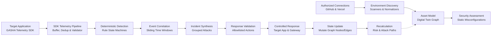

# GAS0C → GASHA Comprehensive Migration Audit Report
**Phase 1: Source Audit and Target Repository Discovery**  
**Date:** October 9, 2026  
**Auditor:** Antigravity AI Assistant  
**Status:** Audit Completed — Implementation Blocked Awaiting User Approval  

---

## 1. Executive Summary

This audit report establishes the authoritative baseline for rebuilding the **GASHA** platform using implementation artifacts from the existing **GAS0C** cybersecurity operations center.

In strict adherence to Phase 1 guidelines:
- **No production source files have been modified, deleted, migrated, or refactored.**
- **Both source and target codebases have been identified, retrieved, and inspected directly from source trees and git histories.**
- **All AI and Live OSINT components have been inventoried and mapped for safe decoupling.**
- **Baseline test commands have been executed and recorded.**

---

## 2. Repository Identity

### 2.1 Source Repository: GAS0C
* **Active Working Directory:** `C:\Users\X\Documents\antigravity\amazing-mendeleev`
* **Secondary Archive Reference:** `D:\TG\GAS0C-main\GAS0C-main`
* **Git Remote URL:** `https://github.com/abeni74/GAS0C.git`
* **Active Branch:** `cbe-live-defense`
* **Current Commit SHA:** `c540bdc6e5c83fc35649989fe32448ca33eb1f26`
* **Commit Message:** `feat: Add clear incidents endpoint, blocklist UI link, red/yellow status badges`
* **Antigravity Context:**
  * Project: `amazing-mendeleev`
  * Conversation ID on Disk: `61b817cb-77c0-426b-884c-e253152bf4a9` *(Note: User prompt cited `61b817cb-77c0-426b-884e-c253152bf4a9`; verified on disk with segment `884c`)*
  * Conversation Title: `GitHub Repository Collaboration Setup`
  * Historical Artifacts Found: `SYSTEM_GUIDE.md`, `ECOSYSTEM_GUIDE.md` (detailing the 4-microservice architecture: SOC on `:8000`, Client Banking App on `:8080`, Security Gateway on `:8088`, Attacker GUI on `:8090`).

### 2.2 Target Repository: GASHA
* **Active Working Directory:** `d:\CODING\GASHA`
* **Authoritative Upstream Remote:** `https://github.com/YordanosBisrat/Gasha.git` (`upstream`)
* **Upstream Default Branch:** `main`
* **Upstream Head Commit SHA:** `0cc7cb7255fcb1f81f1ecd7e5a42bd371ded5b0e`
* **Upstream Head Commit Message:** `ci: fix pnpm run typecheck argument syntax`
* **Local / Fork Remote:** `https://github.com/NaodBrhane2738/GASHA.git` (`origin`)
* **Current Checked-Out Branch:** `main`
* **Local Head Commit SHA:** `35a456345ecb376c666324d2d483ae59f6354146`
* **Local Head Commit Message:** `feat(ai): add AI context pipeline, providers, semantic validation, and evidence ledger` (adds 151 files / 26,825 lines under `apps/api/app/ai/`)

---

## 3. Actual Target Repository (GASHA) Structure

The target GASHA repository is structured as a **Turborepo monorepo** with `pnpm-workspace.yaml`, consisting of shared typed contracts, a FastAPI backend, a Next.js web application, a telemetry SDK, detection rules, and an instrumented demo target application.

```
GASHA/
├── .env.example                               # Global environment configuration template
├── .gitignore
├── CONTRIBUTING.md
├── LICENSE
├── README.md
├── docker-compose.yml
├── package.json                               # Root monorepo scripts & devDependencies
├── pnpm-workspace.yaml                        # Monorepo workspace definition
├── turbo.json                                 # Turborepo task pipelines
├── .github/
│   ├── pull_request_template.md
│   ├── ISSUE_TEMPLATE/
│   │   ├── bug_report.md
│   │   └── feature_request.md
│   └── workflows/
│       └── ci.yml                             # Monorepo CI: contract typecheck & ruff lint
├── apps/
│   ├── api/                                   # FastAPI Backend Service (Port 4000)
│   │   ├── app/
│   │   │   ├── main.py                        # FastAPI entry point & router registration
│   │   │   ├── adaptive/                      # Adaptive-defense closed-loop orchestrator
│   │   │   │   ├── orchestrator.py
│   │   │   │   ├── recalculation.py
│   │   │   │   └── state_manager.py
│   │   │   ├── ai/                            # [SCHEDULED FOR DECOUPLING] AI context & reasoning
│   │   │   │   ├── __init__.py
│   │   │   │   ├── context_builder.py
│   │   │   │   ├── context_filters.py
│   │   │   │   ├── context_normalizer.py
│   │   │   │   ├── context_selectors.py
│   │   │   │   ├── contracts.py
│   │   │   │   ├── evidence_ledger.py
│   │   │   │   ├── pipeline.py
│   │   │   │   ├── semantic_validator.py
│   │   │   │   ├── service.py
│   │   │   │   ├── validation.py
│   │   │   │   ├── prompts/                   # Prompt templates (attack story, investigations)
│   │   │   │   ├── providers/                 # LLM providers (Ollama, base)
│   │   │   │   ├── recommendations/           # AI response recommendation generators
│   │   │   │   ├── evaluations/               # Evaluation test cases (cases 1-15)
│   │   │   │   └── tests/                     # 173 AI test cases
│   │   │   ├── api/                           # Sub-router implementations (stubs/mocks)
│   │   │   │   ├── assets.py
│   │   │   │   ├── attack_paths.py
│   │   │   │   ├── auth.py
│   │   │   │   ├── connections.py
│   │   │   │   ├── detections.py
│   │   │   │   ├── discovery.py
│   │   │   │   ├── environment.py
│   │   │   │   ├── graph.py
│   │   │   │   ├── incidents.py
│   │   │   │   ├── investigations.py          # AI investigation routes
│   │   │   │   ├── realtime.py                # WebSocket live stream
│   │   │   │   ├── responses.py               # Controlled containment action endpoints
│   │   │   │   ├── risks.py
│   │   │   │   ├── telemetry.py               # Ingestion endpoint (/api/v1/telemetry/ingest)
│   │   │   │   └── vulnerabilities.py
│   │   │   ├── attack_paths/                  # Placeholder (.gitkeep)
│   │   │   ├── core/                          # Cross-cutting foundational modules
│   │   │   │   ├── auth.py                    # JWT & telemetry API key validation
│   │   │   │   ├── config.py                  # Pydantic Settings with Supabase & AI keys
│   │   │   │   ├── errors.py
│   │   │   │   ├── logging.py
│   │   │   │   └── security.py                # Password hashing and token generation
│   │   │   ├── correlation/                   # Placeholder (.gitkeep)
│   │   │   ├── db/                            # Database connection & models
│   │   │   │   ├── database.py                # Supabase client singleton & session provider
│   │   │   │   ├── models/                    # Placeholder (.gitkeep)
│   │   │   │   └── repositories/              # Placeholder (.gitkeep)
│   │   │   ├── detection/                     # Placeholder (.gitkeep)
│   │   │   │   └── rules/                     # Placeholder (.gitkeep)
│   │   │   ├── digital_twin/                  # In-memory graph builder & state representation
│   │   │   │   ├── builder.py
│   │   │   │   ├── graph.py
│   │   │   │   ├── queries.py
│   │   │   │   └── state.py
│   │   │   ├── discovery/                     # Cloud environment scanners & normalizers
│   │   │   │   ├── deduplicator.py
│   │   │   │   ├── normalizer.py
│   │   │   │   ├── relationships.py
│   │   │   │   └── scanner.py
│   │   │   ├── integrations/
│   │   │   │   ├── github/                    # Placeholder (.gitkeep)
│   │   │   │   └── vercel/                    # Placeholder (.gitkeep)
│   │   │   ├── investigation/                 # Placeholder (.gitkeep)
│   │   │   ├── response/
│   │   │   │   └── actions/                   # Placeholder (.gitkeep)
│   │   │   ├── risk/                          # Placeholder (.gitkeep)
│   │   │   ├── schemas/                       # Pydantic validation schemas
│   │   │   │   ├── asset.py
│   │   │   │   ├── attack_path.py
│   │   │   │   ├── connection.py
│   │   │   │   ├── detection.py
│   │   │   │   ├── incident.py
│   │   │   │   ├── investigation.py
│   │   │   │   ├── response.py
│   │   │   │   ├── risk.py
│   │   │   │   └── telemetry.py
│   │   │   ├── security_assessment/           # Placeholder (.gitkeep)
│   │   │   │   └── rules/                     # Placeholder (.gitkeep)
│   │   │   ├── telemetry/                     # Telemetry ingestion buffer & processing
│   │   │   │   ├── ingester.py
│   │   │   │   ├── normalizer.py
│   │   │   │   ├── processor.py
│   │   │   │   └── validator.py
│   │   │   └── workers/                       # Async pipeline background workers
│   │   │       ├── discovery.py
│   │   │       ├── recalculation.py
│   │   │       └── telemetry.py
│   │   └── tests/
│   │       ├── e2e/                           # Placeholder (.gitkeep)
│   │       ├── integration/                   # Placeholder (.gitkeep)
│   │       └── unit/                          # Placeholder (.gitkeep)
│   ├── demo-target/                           # Target Application for Live Defense Demos
│   │   ├── package.json
│   │   ├── security/                          # Target active defense enforcement hooks
│   │   │   ├── blocklist.py                   # In-memory IP blocklist
│   │   │   ├── middleware.py                  # ASGI security enforcement middleware
│   │   │   └── sessions.py                    # Session invalidation tracker
│   │   ├── telemetry/                         # Target application telemetry instrumentation
│   │   │   ├── client.py                      # Local client wrapper
│   │   │   ├── emitter.py                     # Convenience emitters (auth, access)
│   │   │   └── events.py                      # Event definitions
│   │   ├── api/                               # Placeholder (.gitkeep)
│   │   ├── app/                               # Placeholder (.gitkeep)
│   │   ├── components/                        # Placeholder (.gitkeep)
│   │   ├── db/                                # Placeholder (.gitkeep)
│   │   ├── lib/                               # Placeholder (.gitkeep)
│   │   ├── tests/                             # Placeholder (.gitkeep)
│   │   └── vulnerabilities/                   # Placeholder (.gitkeep)
│   └── web/                                   # Next.js Frontend Dashboard (Port 3000)
│       ├── package.json
│       ├── app/
│       │   ├── dashboard/
│       │   │   ├── page.tsx                   # Main security command center dashboard page
│       │   │   ├── attack-paths/              # Placeholder (.gitkeep)
│       │   │   ├── attack-surface/            # Placeholder (.gitkeep)
│       │   │   ├── environment/               # Placeholder (.gitkeep)
│       │   │   ├── incidents/                 # Placeholder (.gitkeep)
│       │   │   ├── investigations/            # Placeholder (.gitkeep)
│       │   │   ├── responses/                 # Placeholder (.gitkeep)
│       │   │   └── settings/                  # Placeholder (.gitkeep)
│       │   ├── (auth)/                        # Placeholder (.gitkeep)
│       │   ├── api/                           # Placeholder (.gitkeep)
│       │   ├── connections/                   # Placeholder (.gitkeep)
│       │   └── onboarding/                    # Placeholder (.gitkeep)
│       └── components/                        # UI and domain components (.gitkeep)
├── packages/
│   ├── contracts/                             # Single-Source-Of-Truth TypeScript Contracts
│   │   ├── package.json
│   │   ├── tsconfig.json
│   │   ├── README.md
│   │   ├── index.ts                           # Root barrel export
│   │   ├── api/
│   │   │   └── index.ts                       # API request/response types
│   │   ├── entities/
│   │   │   └── index.ts                       # Asset, Relationship, Incident, Risk, AttackPath
│   │   ├── events/
│   │   │   └── index.ts                       # TelemetryEvent, DetectionEvent, SystemEvent
│   │   └── responses/
│   │       └── index.ts                       # ResponseActionRequest, ExecutionResult, Audit
│   ├── detection-rules/                       # Shared Detection Rules Specifications
│   │   ├── package.json
│   │   ├── schemas/
│   │   │   └── index.ts                       # Rule definition schemas
│   │   └── web/
│   │       └── index.ts                       # BRUTE_FORCE_AUTH_RULE, SUSPICIOUS_PROBE_RULE
│   ├── telemetry-sdk/                         # Client Instrumentation SDK
│   │   ├── package.json
│   │   ├── python/
│   │   │   └── gasha_telemetry.py             # Python Telemetry Client (GashaTelemetryClient)
│   │   └── typescript/
│   │       └── index.ts                       # TypeScript Telemetry Client
│   └── ui/                                    # Shared React Component Library
│       ├── package.json
│       ├── components/
│       │   └── index.tsx                      # SeverityBadge, RiskDial, StatusPill
│       ├── icons/
│       │   └── index.tsx                      # Icon wrappers
│       └── styles/
│           └── index.css                      # Tailwind styles
├── docs/
│   ├── architecture/
│   │   ├── adaptive-loop.md                   # 12-step closed loop documentation
│   │   ├── data-flow.md                       # Data flow sequence
│   │   └── overview.md                        # Architecture overview & component diagram
│   ├── competition/
│   │   ├── demo.md                            # Competition demo scenario narrative
│   │   ├── mvp.md                             # Competition MVP scope boundaries
│   │   └── scope.md                           # Team ownership breakdown
│   ├── decisions/
│   │   ├── 0001-single-source-of-truth-contracts.md
│   │   └── 0002-adaptive-defense-loop-orchestration.md
│   └── integrations/
│       ├── github.md                          # GitHub permissions & dependency scanning
│       └── vercel.md                          # Vercel REST API endpoints & resources
└── tests/                                     # Cross-package test suites
    ├── contract/                              # Placeholder (.gitkeep)
    ├── e2e/                                   # Placeholder (.gitkeep)
    └── scenarios/                             # Placeholder (.gitkeep)
```

---

## 4. GAS0C Backend Source Audit

Every component in the source GAS0C codebase (`C:\Users\X\Documents\antigravity\amazing-mendeleev`) was inspected:

### 4.1 FastAPI Application and Route Registration
* **Source Path:** `GAS0C/app/main.py` (857 lines)
* **What it does:** Central FastAPI application declaring public and private endpoints, mounting static assets/Jinja2 templates, hosting Server-Sent Events (SSE) telemetry stream (`/api/v1/events/stream`), Wazuh webhook ingestion (`/api/v1/alerts/webhook`), agent telemetry batch ingestion (`/api/v1/telemetry`), PTES reporting, active containment endpoints, and session archiving.
* **Status:** Functional in GAS0C, but monolithic. In GASHA, routes are cleanly factored into `apps/api/app/api/*.py`.
* **Decision:** **ADAPT** route logic from GAS0C into GASHA's modular route files (`telemetry.py`, `incidents.py`, `responses.py`, `realtime.py`).

### 4.2 Authentication and Authorization
* **Source Path:** `GAS0C/app/main.py` (lines 47–96)
* **What it does:** HMAC-SHA256 cookie signing for interactive web sessions (`session_user`), header-based agent token validation (`X-GAS0C-Agent-Token` vs `settings.GAS0C_AGENT_TOKEN`), and Gateway control secret (`X-GAS0C-Control-Key`).
* **Status:** Functional, but uses cookies and simple shared tokens.
* **Decision:** **ADAPT** to GASHA's `apps/api/app/core/auth.py` and `security.py` (JWT bearer tokens for users, `X-GASHA-TELEMETRY-KEY` for telemetry SDK).

### 4.3 Configuration and Environment Handling
* **Source Path:** `GAS0C/app/config.py` (46 lines)
* **What it does:** Basic Pydantic `BaseModel` settings with `os.getenv` defaults.
* **Status:** Functional.
* **Decision:** **ADAPT**. GASHA already has a structured `pydantic_settings.BaseSettings` in `apps/api/app/core/config.py` supporting Supabase, Vercel, and GitHub settings.

### 4.4 Database Models, Repositories, and Persistence
* **Source Path:** `GAS0C/app/services/repository.py` (129 lines), `GAS0C/app/models/incident.py`, `alert.py`, `telemetry.py`
* **What it does:** Thread-safe in-memory dictionary storage (`_incidents`, `_attack_groups`) with helper query methods (`get_all`, `get_pending`, `get_governed`, `find_or_create_group`, `approve_containment`).
* **Status:** Functional in-memory repository with zero persistent database dependency.
* **Decision:** **ADAPT**. Can be ported directly into `apps/api/app/db/repositories/incident_repository.py` and augmented with optional Supabase PostgreSQL persistence via `apps/api/app/db/database.py`.

### 4.5 Existing Incident Lifecycle & Correlation
* **Source Path:** `GAS0C/app/services/telemetry_adapter.py` (329 lines), `GAS0C/app/models/incident.py`
* **What it does:** Tracks attack lifecycles using `CorrelationWindow` (30-second sliding time window per IP), deduplication cache (LRU 5000 items), aggregates discrete events into `AttackGroup` records, and transitions statuses (`DETECTED` → `INVESTIGATING` → `RESPONSE_AVAILABLE` → `BLOCKED` → `VERIFICATION_PASSED` → `RESOLVED`).
* **Status:** Fully functional, highly deterministic.
* **Decision:** **REUSE & ADAPT** into `apps/api/app/correlation/` and `apps/api/app/telemetry/normalizer.py`.

### 4.6 Telemetry Ingestion, Validation, and Event Normalization
* **Source Path:** `GAS0C/app/main.py` (`POST /api/v1/telemetry`, lines 587–734) and `telemetry_adapter.py`
* **What it does:** Accepts single or batch telemetry payloads from endpoint sensors, validates source agent IDs, extracts real client IP behind reverse proxies (`x-forwarded-for` / `x-real-ip`), dedupes event IDs, updates velocity metrics, and triggers incident creation.
* **Status:** Fully functional, hardened against IP spoofing.
* **Decision:** **REUSE & ADAPT** into `apps/api/app/api/telemetry.py` and `apps/api/app/telemetry/validator.py`.

### 4.7 Detection Rules and Scoring
* **Source Path:** `GAS0C/app/services/telemetry_adapter.py` (lines 140–210), `gateway/inspection.py`
* **What it does:** Regex and threshold matchers for SQL injection (`SQLI_PATTERN`), Cross-Site Scripting (`XSS_PATTERN`), Path Traversal (`TRAVERSAL_PATTERN`), Brute Force credential spraying (`AUTH_FAILURE` threshold), and sensitive endpoint enumeration.
* **Status:** Fully functional deterministic detection logic.
* **Decision:** **REUSE & ADAPT** to match GASHA's `packages/detection-rules/web/index.ts` specifications into `apps/api/app/detection/`.

### 4.8 Asset and Environment Models
* **Source Path:** `GAS0C/app/models/telemetry.py` (`source`, `destination`, `client_id`, `endpoint`)
* **What it does:** Implicitly models assets through strings (`target_host`, `client-app`, `prod-web-01`).
* **Status:** Primitive in GAS0C.
* **Decision:** **REBUILD**. Adopt GASHA's formal `Asset` and `Relationship` domain entities (`@gasha/contracts/entities/index.ts` and `apps/api/app/schemas/asset.py`).

### 4.9 Vulnerability Assessment, Risk Calculations, and Attack-Path Logic
* **Source Path:** In GAS0C, risk and attack-path concepts were limited to static MITRE ATT&CK mapping cards (`T1110`, `T1078`, `T1059`, `T1190`) and simulated CVSS scores in `ptes_service.py`.
* **Status:** Incomplete/placeholder in GAS0C.
* **Decision:** **REBUILD** natively in GASHA using graph traversal in `apps/api/app/digital_twin/`, `apps/api/app/risk/`, and `apps/api/app/attack_paths/`.

### 4.10 Human-Approved Response Actions & Containment
* **Source Path:** `GAS0C/app/services/active_response.py` (344 lines)
* **What it does:** Enforces Zero Unapproved Destructive Action Policy (HITL). Upon operator approval, validates IP address syntax via `ipaddress.ip_address()`, strips shell injection characters via regex, dispatches `/control/block` HTTP requests to Security Gateway, and runs automated verification (`verify_gateway_block`).
* **Status:** Fully functional, production-hardened active defense mechanism.
* **Decision:** **REUSE & ADAPT** into `apps/api/app/response/` and `apps/api/app/api/responses.py`.

### 4.11 SHA-256 Audit Logging & Cryptographic Integrity
* **Source Path:** `GAS0C/app/services/archive_service.py` (187 lines)
* **What it does:** Aggregates governed incidents, hashes the canonical string `f"{date}|{operator}|{timestamp}|{count}|{incident_ids}"` using SHA-256, writes an immutable audit record to `gasha_audit.log`, and exports tamper-evident JSON session summaries with verification endpoints.
* **Status:** Fully functional, cryptographically verifiable.
* **Decision:** **REUSE & ADAPT** into `apps/api/app/response/audit.py` and `apps/api/app/schemas/response.py`.

### 4.12 Simulator and Controlled Demo Functionality
* **Source Path:** `GAS0C/simulation/attack_simulator.py`, `attacker/main.py`, `demo/cli.py`
* **What it does:** Replays staged cyber attacks (Phase 1: Recon & Brute Force, Phase 2: Unauthorized Login, Phase 3: SQLi & Reverse Shell) against the target application and demonstrates real-time SOC response.
* **Status:** Fully functional.
* **Decision:** **REUSE & ADAPT** to populate `scripts/demo/` and drive `apps/demo-target/`.

### 4.13 Existing SDK, Middleware, and Client Instrumentation
* **Source Path:** `gas0c_agent/` (`sdk.py`, `client.py`, `middleware.py`, `sanitizers.py`, `models.py`)
* **What it does:** Non-blocking bounded background queue (`queue.Queue(2000)`), worker thread with exponential backoff, recursive credential sanitizer redacting passwords/tokens/keys, Starlette ASGI middleware inspecting query/headers and capturing response codes/latencies.
* **Status:** Highly mature and functional.
* **Decision:** **REUSE & ADAPT** into `packages/telemetry-sdk/python/` and `apps/demo-target/security/middleware.py`.

---

## 5. Audit of AI and Live OSINT Integrations

In accordance with architectural directives, **all AI and Live OSINT integrations are scheduled for removal / complete decoupling** in favor of deterministic pipelines.

### 5.1 AI Integration Inventory

| File Path | Component | Description / Function | Downstream Callers | Impact if Removed |
| :--- | :--- | :--- | :--- | :--- |
| `GAS0C/ml/triage_model.py` | `CyberTriageModel` | TF-IDF + LogisticRegression ML triage model | `triage_agent.py`, `/api/v1/model/predict` | Fallback to deterministic rule severity |
| `GAS0C/ml/train_model.py` | Model training script | Trains scikit-learn model on `wazuh_training_corpus.json` | `/api/v1/model/train` | None when removed |
| `GAS0C/ml/weights/` | Serialized weights | `cyber_triage_model.joblib` | `triage_model.py` | None |
| `GAS0C/app/agents/correlation_mitre_agent.py` | `_generate_ollama_narrative()` | Calls Ollama LLM endpoint `/api/generate` | `mitre_agent.run()` | None; deterministic fallback narrative already exists |
| `d:\CODING\GASHA\apps\api\app\ai/` (151 files) | Entire AI package | Context builder, LLM providers (Ollama), prompt templates, evidence ledger, semantic validation | `apps/api/app/ai/tests/` | None; outside `tests/`, only stubbed in `investigations.py` |
| `d:\CODING\GASHA\apps\api\app\core\config.py` | AI Config keys | `AI_PROVIDER`, `AI_MODEL_NAME`, `OLLAMA_BASE_URL`, `OPENAI_API_KEY`, `ANTHROPIC_API_KEY`, `GEMINI_API_KEY` | `apps/api/app/ai/` | Clean removal; eliminates unused config |
| `d:\CODING\GASHA\apps\api\app\api\investigations.py` | Route stub | `POST /api/v1/investigations/{id}/run` returning mock AI response | None | Replace with deterministic incident briefing |
| `d:\CODING\GASHA\apps\api\app\schemas\investigation.py` | Pydantic Schemas | `InvestigationResultResponse`, `RecommendationSchema` | `investigations.py` | Adapt into deterministic investigation schema |
| `d:\CODING\GASHA\packages\contracts\entities\index.ts` | TS Contracts | `InvestigationResult`, `InvestigationContext`, `AttackStory`, `Recommendation` | `apps/web/` | Retain contract shapes; back with deterministic engine |

### 5.2 Live OSINT Integration Inventory

| File Path | Component | Description / Function | Downstream Callers | Impact if Removed |
| :--- | :--- | :--- | :--- | :--- |
| `GAS0C/app/services/ip_intel_service.py` | `IPIntelService.lookup_ip()` | Calls external HTTP API `http://ip-api.com/json/{ip}` | `threat_intel_agent.py`, `/api/v1/ip/deep-intel` | External network call removed |
| `GAS0C/app/services/ip_intel_service.py` | `resolve_reverse_dns()` | Live socket PTR query (`socket.gethostbyaddr`) | `lookup_ip()` | Network DNS latency removed |
| `GAS0C/app/services/ip_intel_service.py` | Hardcoded heuristics | `KNOWN_TOR_PREFIXES`, `KNOWN_MALICIOUS_ASNS` | `lookup_ip()` | Migrate to static local threat feed if needed |
| `GAS0C/app/services/ip_intel_service.py` | Abuse score heuristic | Computes 0–100% abuse rating | `build_threat_intel_report()` | Replace with deterministic risk score |
| `GAS0C/app/agents/threat_intel_agent.py` | `ThreatIntelAgent` | Calls `ip_intel_service` | `orchestrator.py` | Replace with deterministic asset-context lookup |
| `GAS0C/app/main.py` | Routes | `GET /api/v1/ip/deep-intel`, `GET /intel` | Web templates | Remove external lookup routes |
| `GAS0C/tests/test_ip_intel.py` | Test suite | 3 tests validating IP intel resolution | pytest runner | Retire or replace with static feed tests |

### 5.3 Replacement with Deterministic Narrative Engine
GAS0C already contains `GAS0C/app/services/fallback_analysis.py` (`DeterministicIncidentAnalyzer`). It:
* Operates 100% offline with zero external network or LLM calls.
* Assembles verified incident telemetry, timestamps, MITRE techniques, and target assets.
* Produces structured step-by-step technical analysis and executive briefings.
* Supports real-time SSE token streaming via `stream_analysis_chunks()`.
* Directly satisfies GASHA's requirement for a deterministic, verifiable defensive pipeline.

---

## 6. Intended GASHA Architectural Direction



### 6.1 GitHub Integration
* **Path:** `apps/api/app/integrations/github/`
* **Mechanism:** Least-privilege GitHub App installation or PAT.
* **Capabilities:** Ingests repository metadata, dependency manifests (`package.json`, `requirements.txt`), and Dependabot security alerts.
* **Tenant Isolation:** Secrets stored encrypted server-side; scans partitioned by `environmentId`.

### 6.2 Vercel Integration
* **Path:** `apps/api/app/integrations/vercel/`
* **Mechanism:** Vercel REST API (`Authorization: Bearer <TOKEN>`).
* **Capabilities:** Ingests projects (`/v9/projects`), deployments (`/v6/deployments`), serverless functions, and environment variable keys (values redacted).

### 6.3 GASHA Telemetry SDK Requirements
The SDK (`packages/telemetry-sdk/python/` and `typescript/`) must incorporate the strengths of `gas0c_agent`:
1. **Thread-Safe Asynchronous Queuing:** Non-blocking `enqueue()`, bounded queue (`maxsize=2000`), drops tracked.
2. **Strict Sensitive Data Sanitization:** Recursive redaction of passwords, tokens, API keys, session secrets, authorization headers, and CVV/credit card numbers before serialization.
3. **ASGI / FastAPI Middleware:** Extracts real client IP (proxy and `X-Forwarded-For` aware), correlates request ID, detects suspicious injection probes passively, and records status codes and response latencies.
4. **Structured Event Contract:** Conforms strictly to `@gasha/contracts/events/index.ts` (`AUTH_FAILURE`, `AUTH_SUCCESS`, `HTTP_REQUEST`, `SUSPICIOUS_REQUEST`, `RESOURCE_ACCESS`, `PRIVILEGE_CHANGE`, `OUTBOUND_CONNECTION`).
5. **No Browser-Only Trust:** Telemetry must be emitted server-side by protected backend services.

### 6.4 Deterministic Defensive Pipeline
Eliminates probabilistic LLMs and external OSINT lookups in favor of:
1. Deterministic rule matchers matching `@gasha/detection-rules`.
2. Correlation windows aggregating probes into cohesive incidents.
3. Allowlisted containment actions strictly limited to:
   * `BLOCK_SOURCE` (IP address blocklist)
   * `DISABLE_SESSION` (Session token invalidation)
   * `ISOLATE_RESOURCE` (Asset quarantine in graph)
4. Automated verification probing the perimeter gateway/blocklist.
5. Dynamic digital twin mutation and risk recalculation downward.

---

## 7. Source-to-Target Mapping Table

| Component | GAS0C Source Path | GASHA Target Path | Current Status | Decision | Technical Rationale |
| :--- | :--- | :--- | :--- | :--- | :--- |
| **Telemetry Sanitizer** | `gas0c_agent/sanitizers.py` | `packages/telemetry-sdk/python/sanitizers.py` | Complete in GAS0C | **REUSE** | High-quality recursive regex redaction of credentials/tokens. Safely portable. |
| **Telemetry Background Client** | `gas0c_agent/client.py` | `packages/telemetry-sdk/python/client.py` | Complete in GAS0C | **ADAPT** | Adapt auth headers to `X-GASHA-TELEMETRY-KEY` and payload schema to `@gasha/contracts`. |
| **Telemetry ASGI Middleware** | `gas0c_agent/middleware.py` | `packages/telemetry-sdk/python/middleware.py` | Complete in GAS0C | **ADAPT** | Adapt event types to GASHA's `TelemetryEventType` and proxy IP resolution. |
| **Telemetry SDK Facade** | `gas0c_agent/sdk.py` | `packages/telemetry-sdk/python/gasha_telemetry.py` | Stub in GASHA | **REBUILD** | Replace synchronous httpx client in GASHA SDK with non-blocking threaded queue from GAS0C. |
| **Perimeter Blocklist Manager** | `gateway/blocklist.py` | `apps/demo-target/security/blocklist.py` | Complete in GAS0C | **REUSE** | Thread-safe bounded IP blocklist with expiration and loopback handling fits demo target perfectly. |
| **Perimeter Traffic Inspector** | `gateway/inspection.py` | `apps/demo-target/security/inspection.py` | Complete in GAS0C | **REUSE** | Regex-based Layer 7 intrusion inspection for SQLi, XSS, and path traversal. |
| **Demo Target Middleware** | `gateway/main.py` / `gas0c_agent/middleware.py` | `apps/demo-target/security/middleware.py` | Stub in GASHA | **ADAPT** | Replace stub with real IP blocklist checks and telemetry emission. |
| **Telemetry Ingestion API** | `GAS0C/app/main.py` (`/api/v1/telemetry`) | `apps/api/app/api/telemetry.py` | Stub in GASHA | **ADAPT** | Port batching, rate tracking, and proxy IP extraction into GASHA's router. |
| **Event Deduplication & Correlation** | `GAS0C/app/services/telemetry_adapter.py` | `apps/api/app/telemetry/normalizer.py` & `correlation/` | Complete in GAS0C | **ADAPT** | Port `DeduplicationCache` and `CorrelationWindow` into GASHA pipeline. |
| **Incident In-Memory Repository** | `GAS0C/app/services/repository.py` | `apps/api/app/db/repositories/incident_repository.py` | Complete in GAS0C | **ADAPT** | Port `IncidentRepository` and `AttackGroup` aggregation to conform to GASHA schemas. |
| **Deterministic Investigation Narrative** | `GAS0C/app/services/fallback_analysis.py` | `apps/api/app/investigation/analyzer.py` | Complete in GAS0C | **REUSE** | 100% offline, evidence-grounded briefing generator with SSE streaming. Replaces LLMs. |
| **Investigation API Route** | `GAS0C/app/main.py` (`/stream-analysis`) | `apps/api/app/api/investigations.py` | Mock in GASHA | **ADAPT** | Wire `POST /run` to deterministic analyzer instead of mock/LLM. |
| **Active Containment Execution** | `GAS0C/app/services/active_response.py` | `apps/api/app/response/executor.py` | Complete in GAS0C | **ADAPT** | Port safe IP validation, gateway control dispatch, and automated verification. |
| **Response Actions API** | `GAS0C/app/main.py` (`/api/incidents/{id}/approve`) | `apps/api/app/api/responses.py` | Mock in GASHA | **ADAPT** | Wire `/execute` to real response executor and trigger adaptive recalculation. |
| **SHA-256 Audit Integrity Logger** | `GAS0C/app/services/archive_service.py` | `apps/api/app/response/audit.py` | Complete in GAS0C | **ADAPT** | Port SHA-256 daily session hash calculation and immutable JSON logging. |
| **Realtime Event Stream (SSE/WS)** | `GAS0C/app/services/event_bus.py` | `apps/api/app/api/realtime.py` | Complete in GAS0C | **ADAPT** | Bridge in-memory event pub/sub to GASHA's WebSocket/SSE endpoint. |
| **Attack Simulator Scenarios** | `GAS0C/simulation/attack_simulator.py` | `scripts/demo/run_attack_scenarios.py` | Complete in GAS0C | **ADAPT** | Adapt target URLs and credentials to attack the GASHA demo target (`:3001`). |
| **PTES Technical Report Generator** | `GAS0C/app/services/ptes_service.py` | `apps/api/app/reporting/ptes_generator.py` | Complete in GAS0C | **DEFER** | Highly detailed report generator; defer to Phase 3 after core pipeline is functional. |
| **Scikit-Learn ML Triage Model** | `GAS0C/ml/triage_model.py` | N/A | Exists in GAS0C | **REMOVE** | Excluded per target architecture requirements. |
| **Live IP OSINT Service** | `GAS0C/app/services/ip_intel_service.py` | N/A | Exists in GAS0C | **REMOVE** | Excluded per target architecture requirements. |
| **Wazuh SIEM API Client & Tailer** | `GAS0C/app/services/wazuh_client.py`, `wazuh_tailer.py` | N/A | Exists in GAS0C | **REMOVE** | Replaced by direct native GASHA Telemetry SDK ingestion. |
| **GASHA AI Context Pipeline (151 files)**| N/A | `apps/api/app/ai/` | Added in commit `35a4563` | **REMOVE** | Excluded per target architecture requirements. |
| **Cloud Discovery (GitHub & Vercel)** | N/A (stubs only) | `apps/api/app/integrations/` | Stubs in GASHA | **REBUILD** | Implement authentic GitHub App and Vercel REST API connectors. |
| **Digital Twin Graph & Recalculation** | N/A | `apps/api/app/digital_twin/` & `adaptive/` | Stubs in GASHA | **REBUILD** | Implement in-memory NetworkX/graph representation and adaptive recalculation loop. |

---

## 8. Security and Migration Risks & Mitigations

1. **Risk: Telemetry Event Spoofing or Unauthenticated Ingestion**
   * *Mitigation:* Require explicit `X-GASHA-TELEMETRY-KEY` on `/api/v1/telemetry/ingest`. Enforce tenant and environment boundary checks. Reject payloads without matching credentials.
2. **Risk: Credential and Token Leakage via Telemetry Payloads**
   * *Mitigation:* Reusable recursive sanitizer (`gas0c_agent/sanitizers.py`) must be executed prior to queueing in the SDK and re-verified upon receipt at the ingestion API.
3. **Risk: High Telemetry Ingress Blocking Target Application**
   * *Mitigation:* Port bounded in-memory queue (`queue.Queue(2000)`) with worker thread and `put_nowait()`. Target app returns immediate `202 Accepted`.
4. **Risk: Unsafe Response Action Execution (Command Injection)**
   * *Mitigation:* Enforce strict target validation (`ipaddress.ip_address()`) and regex sanitization. Disallow raw shell command execution. Allow only allowlisted actions (`BLOCK_SOURCE`, `DISABLE_SESSION`, `ISOLATE_RESOURCE`).
5. **Risk: Broken Tenant Isolation during Migration**
   * *Mitigation:* Tag every Asset, TelemetryEvent, Incident, and Audit Record with an explicit `environmentId`.
6. **Risk: False Positives from Missing Context**
   * *Mitigation:* Port sliding-window correlation (`CorrelationWindow`) so single benign anomalies do not trigger critical incidents.

---

## 9. Baseline Test and Verification Results

All tests executed were safe and non-destructive:

| Suite / Check | Command | Status | Result Summary | Details |
| :--- | :--- | :--- | :--- | :--- |
| **GAS0C Test Suite** | `python -m pytest tests/` in `GAS0C` | **EXECUTED** | **57 PASSED, 5 FAILED** (40.14s) | 57 unit/integration tests pass (agents, triage, auth, active response security, event bus, telemetry ingestion). 5 fail due to unseeded mock IDs (`INC-0248`) in in-memory test fixtures. |
| **Gateway Test Suite** | `python -m pytest gateway/tests` in `amazing-mendeleev` | **EXECUTED** | **12 PASSED, 4 FAILED** (10.28s) | Control channel tests pass. 4 failures caused by mock assertion differences in upstream proxy mocks. |
| **GASHA AI Test Suite** | `python -m pytest apps/api/app/ai/tests` in `GASHA` | **EXECUTED** | **168 PASSED, 5 DESELECTED** (5.05s) | Requires `$env:PYTHONPATH="apps/api"`. All context builder, evidence ledger, semantic validator tests pass. |
| **GASHA Core Unit Tests** | `python -m pytest apps/api/tests/` in `GASHA` | **NOT RUN** | 0 test files | Test folders contain only `.gitkeep`. |
| **GASHA FastAPI Import Check**| `python -c "import app.main; print(app.main.app.title)"` | **PASS** | `GASHA Core API` | Application imports and loads router configurations cleanly without syntax or import errors. |
| **GASHA Health Endpoint Check**| `TestClient(app).get('/health')` | **PASS** | HTTP 200 `{"status": "ok", "service": "gasha-api", "version": "0.1.0"}` | Fast, clean response. |
| **TypeScript Contracts Typecheck**| `pnpm --filter @gasha/contracts typecheck` | **BLOCKED** | Missing `pnpm` in global PATH; `node_modules` not yet installed | Node.js v25.9.0 available, but package manager setup needed. |
| **Backend Ruff Lint Check** | `ruff check apps/api/app` | **BLOCKED** | `ruff` not installed in local Python environment | Ruff needs to be installed in environment. |

---

## 10. Phased Migration Plan

### Phase 1: Source Audit & Target Repository Discovery *(THIS PHASE — COMPLETED)*
* Audit both codebases, map dependencies, inventory AI/OSINT, produce source-to-target mapping.

### Phase 2: Core Telemetry SDK & Ingestion Pipeline *(Pending Approval)*
* Adapt `gas0c_agent/sanitizers.py` into `packages/telemetry-sdk/python/`.
* Implement non-blocking background queue client in `packages/telemetry-sdk/python/gasha_telemetry.py`.
* Implement ASGI middleware for automatic request logging and probe inspection.
* Implement real batch ingestion handler in `apps/api/app/api/telemetry.py` with API key validation.

### Phase 3: Deterministic Detection, Correlation, and Incident Repository
* Adapt `telemetry_adapter.py` (dedup cache + 30s sliding correlation window) into `apps/api/app/telemetry/` and `apps/api/app/correlation/`.
* Port `IncidentRepository` and `AttackGroup` aggregation into `apps/api/app/db/repositories/`.
* Wire deterministic detection rules (`RULE-AUTH-001`, `RULE-INJ-002`) into `apps/api/app/detection/`.

### Phase 4: Deterministic Investigation & Controlled Active Response
* Port `fallback_analysis.py` (`DeterministicIncidentAnalyzer`) into `apps/api/app/investigation/`.
* Wire `POST /api/v1/investigations/{id}/run` to deterministic analyzer with SSE streaming.
* Port `active_response.py` containment execution (`BLOCK_SOURCE`, `DISABLE_SESSION`) and Gateway verification into `apps/api/app/response/`.
* Port SHA-256 session integrity logging into `apps/api/app/response/audit.py`.

### Phase 5: Demo Target Defense Integration & Simulator Scenarios
* Equip `apps/demo-target/` with active defense middleware and bounded IP blocklist (`gateway/blocklist.py`).
* Port attack simulation scenarios (`simulation/attack_simulator.py`) into `scripts/demo/`.
* Verify end-to-end closed loop: Attack Probe → SDK Telemetry → Detection → Incident → Operator Approval → Blocklist Containment → Adaptive Recalculation.

### Phase 6: Clean Decoupling of AI & Live OSINT Modules
* Safely remove `apps/api/app/ai/` directory and unused AI configuration keys from `core/config.py` and `.env.example`.
* Verify zero breaking import errors across the entire codebase.

---

## 11. Decisions Requiring User Input

1. **Branch Strategy for Target Changes:**
   * Shall Phase 2 work be committed directly to local branch `main` (fork of Yordanos's repo) or to a dedicated feature branch (e.g. `rebuild/deterministic-pipeline`)?
2. **Timing of AI Directory Removal:**
   * Should the 151 AI files in `apps/api/app/ai/` be kept until Phase 4 (when the deterministic analyzer is fully wired into `investigations.py`), or removed in Phase 2?
3. **Persistence Layer Preference for Incidents:**
   * For the competition demonstration, should the Incident Repository use the fast, reliable in-memory model (from GAS0C) with optional Supabase PostgreSQL sync, or require a mandatory live Supabase connection?
