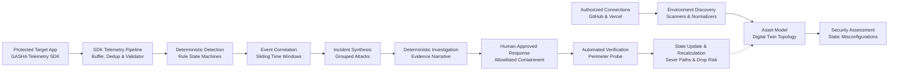

# GAS0C → GASHA Architecture Lock & Migration Plan
**Target Architecture Specification and Phase-by-Phase Implementation Blueprint**  
**Version:** 1.0.0-LOCKED  
**Date:** October 9, 2026  
**Auditor / Architect:** Antigravity AI Assistant  
**Status:** Architecture Locked — Planning Only — Implementation Awaiting Authorization  

---

## 1. Authoritative Repository Identities & Git Baseline

### 1.1 Source Repository (GAS0C)
* **Local Working Directory:** `C:\Users\X\Documents\antigravity\amazing-mendeleev`
* **Git Remote URL:** `https://github.com/abeni74/GAS0C.git`
* **Audited Branch:** `cbe-live-defense`
* **Audited Commit SHA:** `c540bdc6e5c83fc35649989fe32448ca33eb1f26`
* **Commit Message:** `feat: Add clear incidents endpoint, blocklist UI link, red/yellow status badges`
* **Operational Status:** Read-only reference implementation. No modifications permitted.

### 1.2 Target Repository (GASHA)
* **Local Working Directory:** `D:\CODING\GASHA`
* **Authoritative Upstream Remote:** `https://github.com/YordanosBisrat/Gasha.git` (`upstream`)
* **Upstream Head Commit SHA:** `0cc7cb7255fcb1f81fecd7e5a42bd371ded5b0e` (`ci: fix pnpm run typecheck argument syntax`)
* **Fork Remote:** `https://github.com/NaodBrhane2738/GASHA.git` (`origin`)
* **Starting Base Commit:** `35a456345ecb376c666324d2d483ae59f6354146` (`feat(ai): add AI context pipeline, providers, semantic validation, and evidence ledger`)
* **Active Working Branch:** `rebuild/deterministic-pipeline` *(created locally from `main`; 0 commits, 0 pushes)*
* **Working Tree Status:** Clean except untracked planning documents (`docs/GAS0C_TO_GASHA_MIGRATION_AUDIT_REPORT.md` and architecture ADRs). All pre-existing work strictly preserved.

---

## 2. Locked Architectural Direction

GASHA is a **graph-adaptive, purely deterministic defensive cybersecurity platform**.

### 2.1 The Closed-Loop Defensive Progression

### 2.2 Core Design Tenets
1. **Zero LLM / Probabilistic Dependency:** Detection, triage, incident correlation, and investigation narrative generation are 100% deterministic and execute offline without external language models.
2. **Zero Live OSINT Dependency:** External IP intelligence queries (`ip-api.com`, DNS PTR lookups, AbuseIPDB, VirusTotal) are excluded. Threat classification relies exclusively on verified environment metadata, authoritative server-side telemetry, local assessment rules, and observed behavioral evidence.
3. **Reproducible & Testable:** All security decisions produce identical outcomes given identical inputs. Every incident finding is strictly traceable to verified evidence records.
4. **Strict Containment Allowlist:** Active response actions are constrained exclusively to:
   * `BLOCK_SOURCE` (Ingress IP drop enforced at application middleware and perimeter gateway)
   * `DISABLE_SESSION` (Immediate server-side session revocation)
   * `ISOLATE_RESOURCE` (Asset quarantine in the digital twin topology)
   * *Arbitrary shell commands and unapproved destructive actions are strictly prohibited.*
5. **Human-In-The-Loop (HITL) Governance:** High-impact containment actions require explicit human operator approval with immutable SHA-256 cryptographic audit logging.

---

## 3. Architecture Decisions Summary

| Decision ID | Area | Decision Summary | Governing Document |
| :--- | :--- | :--- | :--- |
| **ADR 0001** | Contracts | Single source of truth defined in `@gasha/contracts` and mirrored in backend schemas. | [`0001-single-source-of-truth-contracts.md`](file:///d:/CODING/GASHA/docs/decisions/0001-single-source-of-truth-contracts.md) |
| **ADR 0002** | Adaptive Loop | Closed-loop adaptive defense with deterministic detection and allowlisted responses. | [`0002-adaptive-defense-loop-orchestration.md`](file:///d:/CODING/GASHA/docs/decisions/0002-adaptive-defense-loop-orchestration.md) |
| **ADR 0003** | Deterministic Engine | Exclusion of AI/LLMs and Live OSINT; 100% offline deterministic investigation engine. | [`0003-deterministic-security-pipeline.md`](file:///d:/CODING/GASHA/docs/decisions/0003-deterministic-security-pipeline.md) |
| **ADR 0004** | Persistence | Supabase PostgreSQL production persistence with in-memory test doubles and secret encryption. | [`0004-production-persistence-and-local-testing.md`](file:///d:/CODING/GASHA/docs/decisions/0004-production-persistence-and-local-testing.md) |

---

## 4. Required Target Components Status (Audited)

Every component path specified in the target architecture has been inspected against `D:\CODING\GASHA`:

| Target Component | Repository Path | Current File / Directory Status | Technical State | Implementation Plan |
| :--- | :--- | :--- | :--- | :--- |
| **GitHub Connector** | `apps/api/app/integrations/github/` | Directory exists with `.gitkeep` | **Placeholder** | Implement Octokit/httpx discovery in Phase 7 |
| **Vercel Connector** | `apps/api/app/integrations/vercel/` | Directory exists with `.gitkeep` | **Placeholder** | Implement Vercel REST discovery in Phase 7 |
| **Connections API** | `apps/api/app/api/connections.py` | Exists (37 lines) | **Functional Stub** | Wire to real connectors in Phase 7 |
| **Python Telemetry SDK** | `packages/telemetry-sdk/python/` | `gasha_telemetry.py` (73 lines) | **Functional Skeleton** | Adapt non-blocking queue & sanitizers in Phase 2 |
| **TypeScript Telemetry SDK** | `packages/telemetry-sdk/typescript/` | `index.ts` (14 lines) | **Functional Skeleton** | Complete client implementation in Phase 2 |
| **Telemetry Ingestion API** | `apps/api/app/api/telemetry.py` | Exists (33 lines) | **Functional Stub** | Implement real batch ingestion & auth in Phase 2 |
| **Telemetry Buffer & Ingester**| `apps/api/app/telemetry/` | 4 files (`ingester`, `normalizer`, `processor`, `validator`) | **Scaffold** | Implement dedup, validation, and queuing in Phase 2 |
| **Detection Engine** | `apps/api/app/detection/` | Directory exists with `rules/` and `.gitkeep` | **Placeholder** | Port rule state machines in Phase 3 |
| **Correlation Engine** | `apps/api/app/correlation/` | Directory exists with `.gitkeep` | **Placeholder** | Port sliding correlation window in Phase 3 |
| **Shared Detection Rules** | `packages/detection-rules/web/` | `index.ts` (45 lines) | **Functional Spec** | Rules defined (`RULE-AUTH-001`, `RULE-INJ-002`) |
| **Security Assessment** | `apps/api/app/security_assessment/` | Directory exists with `rules/` and `.gitkeep` | **Placeholder** | Implement static package/route assessment in Phase 8 |
| **Digital Twin Engine** | `apps/api/app/digital_twin/` | 4 files (`builder`, `graph`, `queries`, `state`) | **Scaffold** | Implement graph mutations & queries in Phase 8 |
| **Risk Engine** | `apps/api/app/risk/` | Directory exists with `.gitkeep` | **Placeholder** | Implement 0–100 quantitative risk scoring in Phase 8 |
| **Attack-Path Engine** | `apps/api/app/attack_paths/` | Directory exists with `.gitkeep` | **Placeholder** | Implement graph traversal reachability in Phase 8 |
| **Investigation Engine** | `apps/api/app/investigation/` | Directory exists with `.gitkeep` | **Placeholder** | Adapt deterministic narrative analyzer in Phase 4 |
| **Investigation API** | `apps/api/app/api/investigations.py` | Exists (56 lines) | **Mock Stub** | Wire to deterministic analyzer in Phase 4 |
| **Controlled Response Engine**| `apps/api/app/response/` | Directory exists with `actions/` and `.gitkeep` | **Placeholder** | Port containment executor & audit logger in Phase 4 |
| **Response API** | `apps/api/app/api/responses.py` | Exists (40 lines) | **Mock Stub** | Wire to real execution & adaptive loop in Phase 4 |
| **Adaptive Orchestrator** | `apps/api/app/adaptive/` | 3 files (`orchestrator`, `recalculation`, `state_manager`) | **Scaffold** | Complete closed feedback cycle in Phase 4 & 8 |
| **Demo Target Application** | `apps/demo-target/` | `package.json`, `security/`, `telemetry/` | **Partial Skeleton** | Integrate SDK & blocklist middleware in Phase 5 |
| **Shared Contracts** | `packages/contracts/` | Complete package (`entities`, `events`, `responses`, `api`) | **Fully Established** | Preserve as immutable baseline |
| **Obsolete AI Package** | `apps/api/app/ai/` | 151 files (26,825 lines) | **Legacy / Decouple** | Decouple and remove safely in Phase 6 |

---

## 5. Detailed Phase-by-Phase Migration Plan

### Phase 2: Core SDK and Telemetry Ingestion Pipeline
* **Objective:** Establish the authenticated, high-throughput, non-blocking telemetry data plane between monitored services and the GASHA backend.
* **Prerequisites:** Phase 1 Audit and Phase 2 Architecture Lock complete.
* **Exact Target Files:**
  * Create `packages/telemetry-sdk/python/sanitizers.py` *(Source: `gas0c_agent/sanitizers.py`)*
  * Create `packages/telemetry-sdk/python/client.py` *(Source: `gas0c_agent/client.py`)*
  * Create `packages/telemetry-sdk/python/middleware.py` *(Source: `gas0c_agent/middleware.py`)*
  * Update `packages/telemetry-sdk/python/gasha_telemetry.py` *(Complete SDK facade)*
  * Update `apps/api/app/api/telemetry.py` *(Authenticated ingestion router)*
  * Update `apps/api/app/telemetry/validator.py` *(Server-side schema & rate validation)*
  * Update `apps/api/app/telemetry/ingester.py` *(In-memory buffer & queue)*
* **Implementation Scope:**
  * Port recursive secret sanitizer (redacts passwords, tokens, API keys, bearer auth, session secrets, credit cards).
  * Port thread-safe, non-blocking background queue (`queue.Queue(2000)`) with worker thread, exponential backoff, and observable drop tracking.
  * Port Starlette/FastAPI ASGI telemetry middleware with trusted-proxy IP resolution and passive SQLi/XSS/Traversal inspection tags.
  * Wire backend `/api/v1/telemetry/ingest` with `X-GASHA-TELEMETRY-KEY` authentication and immediate `202 Accepted` response.
* **Testing & Verification:**
  * Unit test: Recursive metadata sanitization under varied nested structures.
  * Unit test: Bounded queue behavior under saturation (assert zero thread blocking, drops incremented).
  * Integration test: TestClient POST to `/api/v1/telemetry/ingest` asserting authentication rejection, payload validation, and accepted status.
* **Acceptance Criteria & Exit Conditions:**
  * Monitored app code executing `client.emit()` never blocks on network I/O.
  * No plaintext credentials survive in serialized telemetry payloads.
  * Ingestion route returns `202 Accepted` in < 15ms.

---

### Phase 3: Deterministic Detection and Correlation Engine
* **Objective:** Port GAS0C's proven detection logic and correlation algorithms into GASHA's modular architecture to cluster telemetry streams into cohesive incidents.
* **Prerequisites:** Phase 2 telemetry ingestion pipeline operational.
* **Exact Target Files:**
  * Create `apps/api/app/detection/engine.py`
  * Create `apps/api/app/detection/rules/auth_brute_force.py` *(Implements `RULE-AUTH-001`)*
  * Create `apps/api/app/detection/rules/suspicious_probe.py` *(Implements `RULE-INJ-002`)*
  * Update `apps/api/app/detection/engine.py`
  * Create `apps/api/app/correlation/window.py` *(Source: `CorrelationWindow` in `telemetry_adapter.py`)*
  * Create `apps/api/app/correlation/dedup.py` *(Source: `DeduplicationCache` in `telemetry_adapter.py`)*
  * Create `apps/api/app/db/repositories/incident_repository.py` *(In-memory repository implementing domain interface)*
  * Update `apps/api/app/api/incidents.py` *(List and get incidents)*
* **Implementation Scope:**
  * Port LRU deduplication cache (5,000 entries) preventing duplicate event processing.
  * Port 30-second sliding correlation window grouping related attack attempts by source IP and target asset.
  * Implement rule state machines matching `@gasha/detection-rules` specifications for Brute Force (5+ failed logins) and Injection Probes.
  * Port `IncidentRepository` and `AttackGroup` aggregation, mapping to `@gasha/contracts/entities/Incident`.
* **Testing & Verification:**
  * Unit test: 5 consecutive `AUTH_FAILURE` events trigger a single High-severity Incident.
  * Unit test: Duplicate event IDs are acknowledged but do not increment incident counters.
  * Unit test: Sliding window expires after 30 seconds of inactivity.
* **Acceptance Criteria & Exit Conditions:**
  * Ingested telemetry automatically generates structured incidents queryable via `GET /api/v1/incidents`.
  * Zero probabilistic or LLM components involved in detection.

---

### Phase 4: Deterministic Investigation and Controlled Response
* **Objective:** Replace mock AI investigation responses with deterministic evidence synthesis and implement allowlisted, audited containment actions.
* **Prerequisites:** Phase 3 Incident repository and detection engine operational.
* **Exact Target Files:**
  * Create `apps/api/app/investigation/analyzer.py` *(Source: `fallback_analysis.py`)*
  * Update `apps/api/app/api/investigations.py` *(Wire `/run` and `/{id}` to analyzer)*
  * Create `apps/api/app/response/executor.py` *(Source: `active_response.py`)*
  * Create `apps/api/app/response/audit.py` *(Source: `archive_service.py`)*
  * Update `apps/api/app/api/responses.py` *(Wire `/execute` and `/audit`)*
  * Update `apps/api/app/api/realtime.py` *(Event bus broadcasting)*
* **Implementation Scope:**
  * Adapt `DeterministicIncidentAnalyzer` to synthesize observed facts, chronological steps, and allowlisted recommendations (`BLOCK_SOURCE`).
  * Implement progressive streaming over Server-Sent Events / WebSocket.
  * Port `ActiveResponseService`: safe target validation (`ipaddress.ip_address()`), command injection prevention, and dispatch to target app / gateway.
  * Port SHA-256 session integrity auditing, appending to `gasha_audit.log` and generating daily session archives.
* **Testing & Verification:**
  * Unit test: Investigation report accurately compiles verified facts for a multi-attempt incident.
  * Security test: Containment target containing shell metacharacters (`192.168.1.1; rm -rf /`) is strictly rejected.
  * Verification test: Executed containment generates valid SHA-256 audit record.
* **Acceptance Criteria & Exit Conditions:**
  * `POST /api/v1/investigations/{id}/run` returns structured, grounded technical briefings without external LLM calls.
  * `POST /api/v1/responses/execute` successfully enforces `BLOCK_SOURCE` and records audit entry.

---

### Phase 5: Demo Target Application and End-to-End Defense Loop
* **Objective:** Instrument the demo target application with the GASHA SDK and blocklist middleware, and verify the end-to-end telemetry-to-containment loop using attack scripts.
* **Prerequisites:** Phases 2, 3, and 4 complete.
* **Exact Target Files:**
  * Update `apps/demo-target/security/blocklist.py` *(Source: `gateway/blocklist.py`)*
  * Update `apps/demo-target/security/middleware.py` *(Enforce 403 on blocked IPs)*
  * Update `apps/demo-target/telemetry/client.py` *(Use completed `@gasha/telemetry-sdk`)*
  * Create `apps/demo-target/app/main.py` *(FastAPI target application running on port 3001)*
  * Create `scripts/demo/attack_simulator.py` *(Source: `simulation/attack_simulator.py`)*
* **Implementation Scope:**
  * Equip demo target with thread-safe `BlocklistManager` supporting immediate edge dropping and expiration.
  * Mount security middleware and telemetry client in the demo target.
  * Port multi-phase attack simulation scripts (Phase 1: Brute Force, Phase 2: SQL Injection).
* **Testing & Verification:**
  * Launch target app on port 3001.
  * Run attack simulation script.
  * Verify GASHA backend generates Incident.
  * Execute `BLOCK_SOURCE` response action.
  * Verify subsequent attack probes from the same IP receive HTTP 403 Access Denied.
* **Acceptance Criteria & Exit Conditions:**
  * Full autonomous defense loop verified: Attacker Probe → SDK Telemetry → Detection → Incident → Operator Approval → Target Blocklist Update → Probes Blocked.

---

### Phase 6: Final AI and Live OSINT Decoupling
* **Objective:** Cleanly remove obsolete AI files, prompts, providers, evaluations, and configuration without breaking the functioning platform.
* **Prerequisites:** Phases 2–5 complete and verified with passing test suites.
* **Exact Target Files:**
  * Safely delete `apps/api/app/ai/` directory (151 legacy files).
  * Update `apps/api/app/core/config.py` *(Remove `AI_PROVIDER`, `AI_MODEL_NAME`, `OLLAMA_BASE_URL`, `OPENAI_API_KEY`, etc.)*
  * Update `.env.example` *(Remove Section 5 AI configuration)*
  * Update `apps/api/app/main.py` *(Ensure clean router imports)*
  * Update `apps/api/app/schemas/investigation.py` *(Clean any residual legacy fields)*
* **Implementation Scope:**
  * Perform global grep for `app.ai` imports across the codebase.
  * Remove legacy directory and obsolete environment settings.
* **Testing & Verification:**
  * Run Python backend import check: `python -c "import app.main"`.
  * Run complete regression test suite across backend and SDK.
* **Acceptance Criteria & Exit Conditions:**
  * Zero references to `app.ai` remain in the codebase.
  * Backend starts cleanly and passes all regression tests.

---

### Phase 7: GitHub and Vercel Cloud Integrations
* **Objective:** Implement secure, authenticated connectors to discover repository assets, deployment topology, and configuration metadata.
* **Prerequisites:** Core pipeline operational.
* **Exact Target Files:**
  * Create `apps/api/app/integrations/github/client.py`
  * Create `apps/api/app/integrations/github/scanner.py`
  * Create `apps/api/app/integrations/vercel/client.py`
  * Create `apps/api/app/integrations/vercel/scanner.py`
  * Update `apps/api/app/discovery/scanner.py`
  * Update `apps/api/app/discovery/normalizer.py`
  * Create `apps/api/app/core/crypto.py` *(Envelope encryption for stored tokens)*
* **Implementation Scope:**
  * GitHub App / PAT connector scanning repos, default branches, and dependency manifests (`package.json`, `requirements.txt`).
  * Vercel REST API connector scanning projects, deployments, and function endpoints.
  * Strict redaction of all environment variable values during ingestion.
  * AES-256-GCM encryption of stored connection tokens.
* **Testing & Verification:**
  * Mock API tests for GitHub repo discovery and dependency manifest parsing.
  * Mock API tests for Vercel deployment discovery.
  * Credential encryption round-trip unit test.
* **Acceptance Criteria & Exit Conditions:**
  * Discovered resources normalize cleanly into `@gasha/contracts/entities/Asset`.
  * No plaintext connection secrets stored in database.

---

### Phase 8: Security Assessment, Risk, and Attack-Path Engines
* **Objective:** Complete the static security assessment rules, Digital Twin graph representation, quantitative 0–100 risk scoring, and graph reachability attack-path calculation.
* **Prerequisites:** Phase 7 discovery and Phase 3 telemetry state operational.
* **Exact Target Files:**
  * Create `apps/api/app/security_assessment/rules/public_exposure.py`
  * Create `apps/api/app/security_assessment/rules/vulnerable_dependency.py`
  * Update `apps/api/app/digital_twin/graph.py` *(In-memory NetworkX directed graph)*
  * Create `apps/api/app/risk/engine.py` *(0–100 scoring model)*
  * Create `apps/api/app/attack_paths/calculator.py` *(Dijkstra / BFS path reachability)*
  * Update `apps/api/app/adaptive/orchestrator.py` *(Closed-loop recalculation on containment)*
* **Implementation Scope:**
  * Rule checkers for public route exposure and vulnerable dependencies.
  * Digital Twin graph builder connecting assets via `CALLS`, `DEPENDS_ON`, `CONNECTS_TO`.
  * Quantitative risk formula weighting criticality (Tier-0 crown jewels) and active attack paths.
  * Adaptive recalculation: when `BLOCK_SOURCE` or `ISOLATE_RESOURCE` executes, severed edge updates graph and drops risk score immediately.
* **Testing & Verification:**
  * Unit test: Graph traversal successfully identifies viable paths from public ingress to crown jewel DB.
  * Closed-loop test: Executing containment action severs path and reduces risk score.
* **Acceptance Criteria & Exit Conditions:**
  * Real-time risk recalculation verified and broadcast across WebSocket.

---

### Phase 9: Final Integration, Verification, and Competition Readiness
* **Objective:** Full platform integration testing, frontend dashboard verification, performance profiling, and operational documentation.
* **Prerequisites:** Phases 2–8 complete.
* **Exact Target Files:**
  * `tests/e2e/test_complete_defense_loop.py`
  * `docs/competition/demo.md`
  * `README.md`
* **Implementation Scope:**
  * End-to-end multi-tenant validation.
  * Verification of Next.js frontend command center (`apps/web`) consuming live backend APIs.
  * Pre-flight health checks and automated demo verification scripts.
* **Testing & Verification:**
  * Full automated regression suite.
* **Acceptance Criteria & Exit Conditions:**
  * All test suites passing.
  * System operates with 100% determinism and zero unhandled exceptions.

---

## 6. Detailed Connector Security Requirements

The GitHub and Vercel integrations must be built to production security standards:

1. **Least-Privilege Authorization:**
   * GitHub: Restricted exclusively to `metadata:read` and `dependabot_alerts:read` (or repository content read for manifests). Administrative, write, and code modification permissions are rejected.
   * Vercel: Restricted to `read-only` project and deployment scopes.
2. **Encrypted Token Storage:**
   * Connection tokens, webhook secrets, and private keys must be encrypted at rest using AES-256-GCM authenticated encryption prior to database storage.
   * Encryption keys are managed server-side via `GASHA_ENCRYPTION_KEY` and never exposed via APIs.
3. **Strict Secret Redaction:**
   * When discovering Vercel project environment configurations, only variable keys/names may be recorded for topology mapping. Variable values must be strictly redacted before persistence.
4. **Resilient API Handling:**
   * Pagination support for repositories and deployments.
   * Bounded exponential backoff and retry (max 3 retries) on HTTP 429 Rate Limit responses.
   * Graceful degradation on partial upstream API errors without failing the entire discovery cycle.
5. **Tenant & Environment Isolation:**
   * Every connection, discovered asset, and dependency record is strictly partitioned by `tenant_id` and `environment_id`. Cross-tenant data access is impossible by design.

---

## 7. Detailed SDK Security Requirements

The GASHA Telemetry SDK (`packages/telemetry-sdk/python/`) must preserve all architectural strengths identified during the GAS0C audit:

1. **Thread-Safe Asynchronous Queuing:**
   * Non-blocking `enqueue()` / `emit()` method using `queue.Queue(maxsize=2000)` and `put_nowait()`.
   * Monitored applications must **never** be blocked or delayed by telemetry transmission.
   * Dropped event counters are maintained in memory and exposed in SDK health status.
2. **Recursive Secret & PII Sanitization:**
   * All event payloads must be sanitized recursively before serialization.
   * Keys matching sensitive patterns (`password`, `secret`, `token`, `auth`, `cookie`, `api_key`, `session`, `private_key`, `credit_card`, `cvv`) are replaced with `[REDACTED]`.
   * Bearer token strings and JWT patterns in text values are redacted.
3. **Server-Side ASGI Middleware:**
   * Automatically captures incoming HTTP transactions, measures response latency, and records HTTP status codes.
   * Includes passive Layer 7 pattern matchers tagging SQL injection, XSS, and directory traversal probes.
4. **Trusted-Proxy Client IP Resolution:**
   * Distinguishes observed peer address from forwarded addresses.
   * Only trusts `X-Forwarded-For` or `X-Real-IP` headers when received from explicitly configured trusted upstream reverse proxies.
5. **Fail-Safe Operation:**
   * Network errors or unavailability of the GASHA backend must be swallowed gracefully with local error logging; they must never raise unhandled exceptions in the host application.

---

## 8. Source-to-Target Implementation Mapping

| GAS0C Source Path | GASHA Target Path | Status | Action | Implementation Rationale |
| :--- | :--- | :--- | :--- | :--- |
| `gas0c_agent/sanitizers.py` | `packages/telemetry-sdk/python/sanitizers.py` | Complete | **REUSE** | High-quality recursive regex redaction of credentials/tokens. Safely portable. |
| `gas0c_agent/client.py` | `packages/telemetry-sdk/python/client.py` | Complete | **ADAPT** | Adapt auth headers to `X-GASHA-TELEMETRY-KEY` and payload schema to `@gasha/contracts`. |
| `gas0c_agent/middleware.py` | `packages/telemetry-sdk/python/middleware.py` | Complete | **ADAPT** | Adapt event types to GASHA's `TelemetryEventType` and proxy IP resolution. |
| `gas0c_agent/sdk.py` | `packages/telemetry-sdk/python/gasha_telemetry.py` | Skeleton | **REBUILD** | Replace synchronous httpx client in GASHA SDK with non-blocking threaded queue from GAS0C. |
| `gateway/blocklist.py` | `apps/demo-target/security/blocklist.py` | Complete | **REUSE** | Thread-safe bounded IP blocklist with expiration and loopback handling fits demo target perfectly. |
| `gateway/inspection.py` | `apps/demo-target/security/inspection.py` | Complete | **REUSE** | Regex-based Layer 7 intrusion inspection for SQLi, XSS, and path traversal. |
| `gateway/main.py` | `apps/demo-target/security/middleware.py` | Skeleton | **ADAPT** | Replace stub with real IP blocklist checks and telemetry emission. |
| `GAS0C/app/main.py` (`/api/v1/telemetry`) | `apps/api/app/api/telemetry.py` | Stub | **ADAPT** | Port batching, rate tracking, and proxy IP extraction into GASHA's router. |
| `GAS0C/app/services/telemetry_adapter.py` | `apps/api/app/telemetry/normalizer.py` & `correlation/` | Complete | **ADAPT** | Port `DeduplicationCache` and `CorrelationWindow` into GASHA pipeline. |
| `GAS0C/app/services/repository.py` | `apps/api/app/db/repositories/incident_repository.py` | Complete | **ADAPT** | Port `IncidentRepository` and `AttackGroup` aggregation to conform to GASHA schemas. |
| `GAS0C/app/services/fallback_analysis.py` | `apps/api/app/investigation/analyzer.py` | Complete | **REUSE** | 100% offline, evidence-grounded briefing generator with SSE streaming. Replaces LLMs. |
| `GAS0C/app/main.py` (`/stream-analysis`) | `apps/api/app/api/investigations.py` | Mock | **ADAPT** | Wire `POST /run` to deterministic analyzer instead of mock/LLM. |
| `GAS0C/app/services/active_response.py` | `apps/api/app/response/executor.py` | Complete | **ADAPT** | Port safe IP validation, gateway control dispatch, and automated verification. |
| `GAS0C/app/main.py` (`/api/incidents/{id}/approve`) | `apps/api/app/api/responses.py` | Mock | **ADAPT** | Wire `/execute` to real response executor and trigger adaptive recalculation. |
| `GAS0C/app/services/archive_service.py` | `apps/api/app/response/audit.py` | Complete | **ADAPT** | Port SHA-256 daily session hash calculation and immutable JSON logging. |
| `GAS0C/app/services/event_bus.py` | `apps/api/app/api/realtime.py` | Complete | **ADAPT** | Bridge in-memory event pub/sub to GASHA's WebSocket/SSE endpoint. |
| `GAS0C/simulation/attack_simulator.py` | `scripts/demo/attack_simulator.py` | Complete | **ADAPT** | Adapt target URLs and credentials to attack the GASHA demo target (`:3001`). |
| `GAS0C/app/services/ptes_service.py` | `apps/api/app/reporting/ptes_generator.py` | Complete | **DEFER** | Highly detailed report generator; defer to Phase 9. |
| `GAS0C/ml/triage_model.py` | N/A | Exists | **REMOVE** | Excluded per target architecture requirements. |
| `GAS0C/app/services/ip_intel_service.py` | N/A | Exists | **REMOVE** | Excluded per target architecture requirements. |
| `GAS0C/app/services/wazuh_client.py` | N/A | Exists | **REMOVE** | Replaced by direct native GASHA Telemetry SDK ingestion. |
| `apps/api/app/ai/` (151 files) | N/A | Exists | **REMOVE** | Decouple safely in Phase 6 after Phase 4 is verified. |
| Cloud Discovery (GitHub & Vercel) | `apps/api/app/integrations/` | Stubs | **REBUILD** | Implement authentic GitHub App and Vercel REST API connectors in Phase 7. |
| Digital Twin & Risk Engine | `apps/api/app/digital_twin/`, `risk/`, `attack_paths/` | Stubs | **REBUILD** | Implement NetworkX topology, 0–100 risk scoring, and path reachability in Phase 8. |

---

## 9. Verification & Readiness Assessment

1. **Architecture locked:** Deterministic closed-loop pipeline verified and accepted.
2. **AI/OSINT decoupled safely:** 7-step retirement sequence established without breaking imports.
3. **Dual persistence model:** Supabase PostgreSQL for production, in-memory test doubles for testing.
4. **SDK & Connector security specifications:** Hardened against data leakage, proxy spoofing, and excessive privileges.
5. **Git safety intact:** All work strictly local on `rebuild/deterministic-pipeline`, 0 commits, 0 pushes.
6. **Implementation readiness:** Phase 2 (SDK & Telemetry Ingestion) is completely planned, mapped, and ready for immediate execution upon user authorization.
