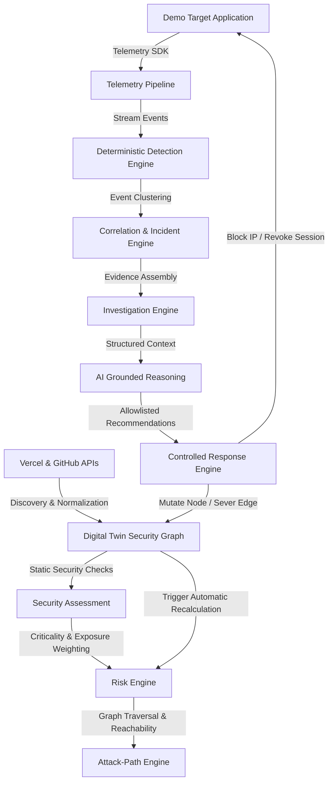

# GASHA System Architecture Overview

> **ROLE / OWNERSHIP**: System Architects & Backend Lead Engineers  
> **OBJECTIVE**: Provide high-level system architecture, component boundaries, and design principles.  
> **EXPECTED RESULT**: Clear technical roadmap for all engineering teams.

---

## 1. Executive Architecture Summary

GASHA is a unified, graph-driven autonomous security platform. It combines static infrastructure discovery from cloud platforms (Vercel, GitHub) with real-time runtime telemetry into a continuous, self-healing **Adaptive-Defense Loop**.

---

## 2. Key Architecture Tenets
1. **Modular Monolith**: One backend service (`apps/api`), avoiding uncoordinated microservice sprawl.
2. **Deterministic Detection**: Detections are triggered strictly through rule state machines and sliding time windows.
3. **Strict AI Grounding**: LLMs only reason over verified structured evidence. Hallucinations are prohibited.
4. **Allowlisted Response Actions**: Only `BLOCK_SOURCE`, `DISABLE_SESSION`, and `ISOLATE_RESOURCE` are permitted.
