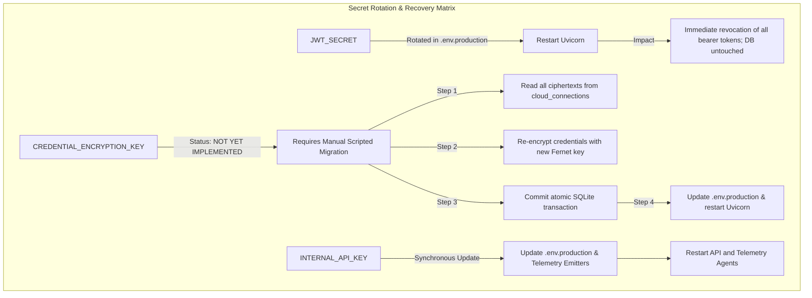

# GASHA Secure Local Demonstration & Evaluation Profile Runbook

**Document Version:** 3.1.0  
**Status:** Authoritative — Local Demonstration & Single-Node Evaluation Operational Standard  
**Target Platform:** Windows PowerShell 5.1 (Runtime-Tested) / PowerShell 7+ (Code-Reviewed Compatible, Host-Untested) / Python 3.11+ / Uvicorn  
**Certified Scope:** Secure Local Demonstration & Single-Node Evaluation Profile  
> [!IMPORTANT]
> **Deployment Scope Limitation:** This runbook certifies GASHA strictly for **local evaluation, competition demonstrations, and single-node development**. It **does NOT certify public-internet production readiness**. Public deployments require upstream TLS termination, multi-worker Redis pub/sub message brokers, managed PostgreSQL, automated key rotation tooling, and external secret stores.

**Supersedes:** All launch instructions in `GASHA_PREDEMO_HARDENING_REPORT.md`, `GASHA_PREDEMO_FINAL_FIX_REPORT.md`, `GASHA_SECRET_LIFECYCLE_VERIFICATION_REPORT.md`, and Runbook v2.0.0

---

## 1. Executive Architecture & Threat Model

This runbook defines the authoritative operational lifecycle for GASHA's local demonstration and single-node evaluation deployments. It incorporates defense-in-depth protections against accidental secret overwrites, UTF-8 BOM encoding corruption, replay verification false positives, ACL validation omissions, proxy header spoofing, and silent startup failures.

### 1.1 Secret Categorization & Lifecycle Separation

| Secret / Parameter | Persistence Location | Generation Method | Lifecycle & Rotation Semantics |
|---|---|---|---|
| `JWT_SECRET` | `.env.production` (Disk) | Instance CSPRNG 32 bytes hex | **Persistent across restarts**. Invalidates all active access tokens when rotated. Zero database rewrite required. |
| `CREDENTIAL_ENCRYPTION_KEY` | `.env.production` (Disk) | Instance CSPRNG 32 bytes URL-safe base64 | **Persistent across restarts**. Encrypts 3rd-party integration tokens (GitHub, Vercel). **Cannot be rotated without database re-encryption migration**. |
| `INTERNAL_API_KEY` | `.env.production` (Disk) | Instance CSPRNG 32 bytes hex | **Persistent across restarts**. Authenticates internal service telemetry. Requires synchronized update in telemetry emitters. |
| `GASHA_PROVISIONING_TOKEN` | Ephemeral Shell Process Memory only | Instance CSPRNG 32 bytes hex | **First-run only**. Never written to disk. Active references removed and environment unset immediately after administrator bootstrap. |
| Initial Administrator Password | Ephemeral Shell Process Memory only | Instance CSPRNG Rejection Sampling (24 chars) | Set via initial `/provision-admin` call. Hashed via PBKDF2-HMAC-SHA256 into SQL storage. Never written to disk or logs. |

### 1.2 Defense-in-Depth Operational Guarantees

1. **Pre-flight Overwrite Guards:** First-run initialization strictly refuses to execute if either `.env.production` or the target SQLite database already exists. This prevents accidental destruction of access to encrypted credentials.
2. **Loopback Binding Only:** Default network binding is strictly restricted to `127.0.0.1`. Never bind to `0.0.0.0` or public network adapters without TLS termination reverse proxies.
3. **Proxy Trust Isolation:** In direct local loopback evaluation, `TRUSTED_PROXIES` is intentionally left empty. If `127.0.0.1` were trusted in direct mode, any local caller could spoof client IP addresses via `X-Forwarded-For`.
4. **Verified NTFS Access Control (Windows):** `.env.production` permissions are stripped of inheritance and granted exclusively to the current Windows principal (`[System.Security.Principal.WindowsIdentity]::GetCurrent().Name`). The resulting ACL is queried and verified before proceeding.
5. **Cross-Version Cryptographically Secure PRNG:** Zero use of `Get-Random` or non-cryptographic seeds. All credentials and passwords use instance-based `[System.Security.Cryptography.RandomNumberGenerator]::Create()` with rejection sampling to eliminate modulo bias across Windows PowerShell 5.1 (.NET Framework 4.8) and PowerShell 7+ (.NET Core).
6. **UTF-8 Without BOM Encoding:** Configuration files are written using .NET `System.Text.UTF8Encoding($false)`. PowerShell 5.1's `Set-Content -Encoding UTF8` automatically prepends a 3-byte Byte Order Mark (`\xef\xbb\xbf`), which corrupts the first environment key in `python-dotenv` / `pydantic-settings` as `\ufeffENVIRONMENT`.
7. **Unambiguous Replay Verification Gate:** Replay testing asserts that token reuse fails. If the server returns HTTP 200, the runbook fails loudly with a critical security alert. Only explicit HTTP 403 or 409 rejection codes are accepted.
8. **Dual-Phase Startup Health Verification:** Both the initial bootstrap server and normal production server verify socket listener liveness, poll `/health`, and confirm both healthy status and `storage_mode: "sql"`.
9. **Staged Database Restoration:** SQLite restores are validated first in an isolated staging database with `PRAGMA integrity_check` and schema invariant tests before promoting to active database, with active rollback copies preserved.

---

## 2. Prerequisites & Pre-flight Checks

Ensure the system meets the following requirements before executing the runbook:

- **Operating System:** Windows 10/11 or Windows Server 2019/2022.
- **Shell:** Windows PowerShell 5.1 or PowerShell 7+.
- **Runtime:** Python 3.11, 3.12, or 3.13 installed and accessible in `PATH`.
- **Working Directory:** Repository root (`D:\CODING\GASHA`).
- **Dependencies:** Virtual environment or system Python packages installed (`fastapi`, `uvicorn`, `cryptography`, `pydantic-settings`, etc.).
- **Port Availability:** Ensure port `8000` (or chosen demo port) is not in use (`netstat -ano | findstr 8000`).

---

## 3. First-Run Provisioning Sequence (Single-Session PowerShell Procedure)

Copy and execute the following complete, self-contained PowerShell procedure. It handles pre-flight checks, secret generation, ACL verification, child process lifecycle, admin bootstrapping, unambiguous replay testing, token retirement, and verification in a single atomic workflow.

```powershell
# ==============================================================================
# GASHA FIRST-BOOT SINGLE-SESSION PROVISIONING SCRIPT (v3.0.0)
# Run from repository root: D:\CODING\GASHA
# Fully compatible with Windows PowerShell 5.1 and PowerShell 7+
# ==============================================================================

$ErrorActionPreference = "Stop"

Write-Host "==========================================================" -ForegroundColor Cyan
Write-Host " GASHA SECURE PRODUCTION BOOTSTRAP (CROSS-VERSION PS) " -ForegroundColor Cyan
Write-Host "==========================================================" -ForegroundColor Cyan

# ------------------------------------------------------------------------------
# Universal HTTP Status Extractor (Compatible across PS 5.1 and PS 7+)
# ------------------------------------------------------------------------------
function Get-HttpStatusFromException($err) {
    if (-not $err) { return $null }
    $ex = $err.Exception
    if (-not $ex) { return $null }

    # 1. PowerShell 7+: HttpResponseException or HttpRequestException with direct StatusCode
    if ($ex.PSObject.Properties['StatusCode'] -and $ex.StatusCode) {
        return [int]$ex.StatusCode
    }

    # 2. Windows PowerShell 5.1 / PS 7: Response object present
    if ($ex.PSObject.Properties['Response'] -and $ex.Response) {
        $resp = $ex.Response
        if ($resp.PSObject.Properties['StatusCode'] -and $resp.StatusCode) {
            return [int]$resp.StatusCode
        }
    }

    # 3. Check InnerException if wrapped
    if ($ex.InnerException) {
        return Get-HttpStatusFromException $err.InnerException
    }

    return $null
}

# ------------------------------------------------------------------------------
# STEP 0: Helper Functions - Compatible Instance-Based CSPRNG
# ------------------------------------------------------------------------------

function Get-SecureHex([int]$numBytes = 32) {
    $bytes = New-Object byte[] $numBytes
    $rng = [System.Security.Cryptography.RandomNumberGenerator]::Create()
    $rng.GetBytes($bytes)
    $rng.Dispose()
    return [System.BitConverter]::ToString($bytes).Replace("-", "").ToLowerInvariant()
}

function Get-SecureBase64UrlSafe([int]$numBytes = 32) {
    $bytes = New-Object byte[] $numBytes
    $rng = [System.Security.Cryptography.RandomNumberGenerator]::Create()
    $rng.GetBytes($bytes)
    $rng.Dispose()
    $b64 = [System.Convert]::ToBase64String($bytes)
    return $b64.Replace("+", "-").Replace("/", "_")
}

function Get-SecurePolicyPassword([int]$length = 24) {
    if ($length -lt 16) { $length = 16 }
    $upper = "ABCDEFGHJKLMNPQRSTUVWXYZ"
    $lower = "abcdefghijkmnopqrstuvwxyz"
    $digits = "23456789"
    $special = "!@#$%^&*-_=+"
    $all = $upper + $lower + $digits + $special
    $rng = [System.Security.Cryptography.RandomNumberGenerator]::Create()

    function Get-UnbiasedChar([string]$s) {
        $len = $s.Length
        $maxAcceptable = 256 - (256 % $len)
        $b = New-Object byte[] 1
        do { $rng.GetBytes($b) } while ($b[0] -ge $maxAcceptable)
        return $s[$b[0] % $len]
    }

    $pwdChars = @(
        (Get-UnbiasedChar $upper), (Get-UnbiasedChar $upper),
        (Get-UnbiasedChar $lower), (Get-UnbiasedChar $lower),
        (Get-UnbiasedChar $digits), (Get-UnbiasedChar $digits),
        (Get-UnbiasedChar $special), (Get-UnbiasedChar $special)
    )
    while ($pwdChars.Count -lt $length) {
        $pwdChars += (Get-UnbiasedChar $all)
    }

    # Unbiased Fisher-Yates shuffle
    $n = $pwdChars.Count
    while ($n -gt 1) {
        $n--
        $range = $n + 1
        $maxAcceptable = 256 - (256 % $range)
        $b = New-Object byte[] 1
        do { $rng.GetBytes($b) } while ($b[0] -ge $maxAcceptable)
        $k = $b[0] % $range
        $tmp = $pwdChars[$k]
        $pwdChars[$k] = $pwdChars[$n]
        $pwdChars[$n] = $tmp
    }
    $rng.Dispose()
    return (-join $pwdChars)
}

# ------------------------------------------------------------------------------
# STEP 1: Pre-flight Overwrite & Port Guards
# ------------------------------------------------------------------------------
$envFile = ".env.production"
$dbFile = "data/gasha_production.db"
$port = 8000

Write-Host "`n[1/9] Checking pre-flight guards..." -ForegroundColor Yellow

$portOccupied = Get-NetTCPConnection -LocalPort $port -ErrorAction SilentlyContinue
if ($portOccupied) {
    throw "ABORT: Port $port is already in use by process ID $($portOccupied.OwningProcess | Select-Object -Unique). Aborting to avoid interference."
}

if (Test-Path $envFile) {
    throw "SAFETY ABORT: Target configuration '$envFile' already exists. First-run bootstrap will NEVER overwrite an existing configuration. If this is an existing deployment, use routine startup."
}
if (Test-Path $dbFile) {
    throw "SAFETY ABORT: Target database '$dbFile' already exists. First-run bootstrap will NEVER attach freshly generated keys to an existing database, as this corrupts encrypted credentials. Use existing keys or follow recovery procedures."
}

if (-not (Test-Path "data")) { New-Item -ItemType Directory -Path "data" | Out-Null }
Write-Host "Pre-flight guards passed: Port $port is free, target paths are clean." -ForegroundColor Green

# ------------------------------------------------------------------------------
# STEP 2: Generate Persistent Secrets and Write .env.production
# ------------------------------------------------------------------------------
Write-Host "`n[2/9] Generating persistent CSPRNG secrets..." -ForegroundColor Yellow
$jwtSecret = Get-SecureHex 32
$encKey = Get-SecureBase64UrlSafe 32
$internalKey = Get-SecureHex 32

$dbPathNorm = $dbFile.Replace("\", "/")
# NOTE ON TRUSTED_PROXIES:
# In direct loopback evaluation (no upstream reverse proxy), TRUSTED_PROXIES is intentionally
# left empty. If 127.0.0.1 were listed as a trusted proxy, direct local callers connecting from
# 127.0.0.1 would be permitted to spoof arbitrary client IP addresses via X-Forwarded-For headers.
# In reverse-proxy mode (e.g. Caddy/Nginx on port 443), set TRUSTED_PROXIES=127.0.0.1 and ensure
# the reverse proxy strictly sanitizes and overwrites inbound X-Forwarded-For headers.
$envContent = @"
ENVIRONMENT=production
NODE_ENV=production
PORT=$port
HOST=127.0.0.1
GASHA_STORAGE_BACKEND=sql
GASHA_DATABASE_PATH=$dbPathNorm
JWT_SECRET=$jwtSecret
CREDENTIAL_ENCRYPTION_KEY=$encKey
INTERNAL_API_KEY=$internalKey
LOG_LEVEL=INFO
TRUSTED_PROXIES=
"@

# Write UTF-8 WITHOUT Byte Order Mark (BOM) to prevent python-dotenv key corruption
[System.IO.File]::WriteAllText((Join-Path (Get-Location) $envFile), $envContent, (New-Object System.Text.UTF8Encoding($false)))
Write-Host "Created $envFile with persistent secrets (UTF-8 no BOM)." -ForegroundColor Green

# ------------------------------------------------------------------------------
# STEP 3: Enforce and Verify NTFS File ACLs & Git Ignore
# ------------------------------------------------------------------------------
Write-Host "`n[3/9] Applying and verifying NTFS ACLs..." -ForegroundColor Yellow
$currentPrincipal = [System.Security.Principal.WindowsIdentity]::GetCurrent().Name
Write-Host "Current Windows principal: $currentPrincipal" -ForegroundColor Gray

$aclOut = icacls $envFile /inheritance:r /grant:r "$($currentPrincipal):(F)" 2>&1
$exitCode = $LASTEXITCODE
if ($exitCode -ne 0) {
    throw "icacls failed with exit code $exitCode. Output: $aclOut"
}

# Inspect resulting ACL
$acl = Get-Acl -Path $envFile
if (-not $acl.AreAccessRulesProtected) {
    throw "ACL SECURITY VIOLATION: Inheritance was not removed from $envFile!"
}

$grantedUsers = @()
foreach ($rule in $acl.Access) {
    $grantedUsers += $rule.IdentityReference.Value
}
$unauthorized = $grantedUsers | Where-Object { $_ -ne $currentPrincipal -and $_ -ne "NT AUTHORITY\SYSTEM" -and $_ -ne "BUILTIN\Administrators" }
if ($unauthorized) {
    throw "ACL SECURITY VIOLATION: Unauthorized entities have access: $($unauthorized -join ', ')"
}
Write-Host "ACL verified: Strictly owner-only access ($currentPrincipal)." -ForegroundColor Green

$gitIgnored = git check-ignore $envFile
if (-not $gitIgnored) {
    throw "GIT SECURITY VIOLATION: $envFile is not excluded by .gitignore!"
}
$gitTracked = git ls-files -- $envFile
if ($gitTracked) {
    throw "GIT SECURITY VIOLATION: Secret file is tracked by Git repository!"
}
Write-Host "Git ignore verified: $envFile is excluded and untracked." -ForegroundColor Green

# ------------------------------------------------------------------------------
# STEP 4: Generate Ephemeral Provisioning Token & Admin Password
# ------------------------------------------------------------------------------
Write-Host "`n[4/9] Generating ephemeral credentials in memory..." -ForegroundColor Yellow
$provToken = Get-SecureHex 32
$env:GASHA_PROVISIONING_TOKEN = $provToken
$adminPassword = Get-SecurePolicyPassword 24
$adminUser = "admin"

Write-Host "Ephemeral token set in process memory (prefix suppressed)." -ForegroundColor Green
Write-Host "Admin Password generated via CSPRNG (length: $($adminPassword.Length))." -ForegroundColor Green

# ------------------------------------------------------------------------------
# STEP 5: Launch Initial Uvicorn Child Process & Verify Health
# ------------------------------------------------------------------------------
Write-Host "`n[5/9] Spawning initial Uvicorn child process (Bootstrap)..." -ForegroundColor Yellow
$env:PYTHONPATH = "apps/api;apps/demo-target;packages/telemetry-sdk/python"

$p1 = Start-Process python -ArgumentList "-m", "uvicorn", "app.main:app", "--env-file", $envFile, "--host", "127.0.0.1", "--port", "$port", "--workers", "1" -PassThru

# Poll /health until ready and confirm SQL mode
$healthy = $false
for ($i = 0; $i -lt 30; $i++) {
    if ($p1.HasExited) {
        throw "Process 1 exited prematurely with code $($p1.ExitCode)!"
    }
    Start-Sleep -Milliseconds 500
    try {
        # Verify socket listener on loopback
        $listener = Get-NetTCPConnection -LocalPort $port -LocalAddress "127.0.0.1" -State Listen -ErrorAction SilentlyContinue
        if ($listener) {
            $res = Invoke-RestMethod -Uri "http://127.0.0.1:$port/health" -Method Get -TimeoutSec 2
            if (($res.status -eq "ok" -or $res.status -eq "healthy") -and $res.storage_mode -eq "sql") {
                $healthy = $true
                break
            }
        }
    } catch {}
}

if (-not $healthy) {
    Stop-Process -Id $p1.Id -Force -ErrorAction SilentlyContinue
    throw "Server failed to respond healthy in SQL mode on http://127.0.0.1:$port/health within 15 seconds."
}
Write-Host "Uvicorn PID $($p1.Id) is HEALTHY and operating in SQL storage mode." -ForegroundColor Green

# ------------------------------------------------------------------------------
# STEP 6: Provision Initial Administrator Account
# ------------------------------------------------------------------------------
Write-Host "`n[6/9] Bootstrapping root administrator account..." -ForegroundColor Yellow
$provBody = @{
    provisioningToken = $provToken
    username = $adminUser
    password = $adminPassword
    environmentId = "env-prod"
} | ConvertTo-Json

$provRes = Invoke-RestMethod -Uri "http://127.0.0.1:$port/api/v1/auth/provision-admin" -Method Post -Body $provBody -ContentType "application/json"
if ($provRes.username -ne $adminUser -or $provRes.role -ne "admin") {
    throw "Administrator provisioning returned unexpected response: $($provRes | ConvertTo-Json)"
}
Write-Host "Administrator provisioned successfully: User '$($provRes.username)', Role '$($provRes.role)'." -ForegroundColor Green

# ------------------------------------------------------------------------------
# STEP 7: Unambiguous Replay Gate, Stop Process 1 & Clear Token
# ------------------------------------------------------------------------------
Write-Host "`n[7/9] Testing replay gate and retiring token..." -ForegroundColor Yellow

$replaySucceeded = $false
$replayStatusCode = 0
$replayErrorMsg = ""

try {
    $replayRes = Invoke-RestMethod -Uri "http://127.0.0.1:$port/api/v1/auth/provision-admin" -Method Post -Body $provBody -ContentType "application/json"
    $replaySucceeded = $true
} catch {
    $replayStatusCode = Get-HttpStatusFromException $_
    $replayErrorMsg = $_.Exception.Message
}

if ($replaySucceeded) {
    Stop-Process -Id $p1.Id -Force
    throw "SECURITY VULNERABILITY: /provision-admin replay succeeded with HTTP 200! Token reuse was not blocked."
}

if ($replayStatusCode -ne 403 -and $replayStatusCode -ne 409) {
    Stop-Process -Id $p1.Id -Force
    throw "REPLAY VERIFICATION FAILED: Expected rejection HTTP 403 or 409, but received status $replayStatusCode. Error: $replayErrorMsg"
}
Write-Host " [PASS] Replay Gate: Correctly rejected with HTTP $replayStatusCode (403 or 409 expected)." -ForegroundColor Green

# Stop Child Process 1
Stop-Process -Id $p1.Id -Force
$p1.WaitForExit()

# Remove active references and clear environment variable
$provToken = $null
$provBody = $null
$env:GASHA_PROVISIONING_TOKEN = $null
[System.Environment]::SetEnvironmentVariable("GASHA_PROVISIONING_TOKEN", $null, "Process")
Write-Host "GASHA_PROVISIONING_TOKEN active references removed and environment cleared." -ForegroundColor Green

# ------------------------------------------------------------------------------
# STEP 8: Start Production Uvicorn WITHOUT Provisioning Token
# ------------------------------------------------------------------------------
Write-Host "`n[8/9] Launching production Uvicorn (child process 2) without token..." -ForegroundColor Yellow
$p2 = Start-Process python -ArgumentList "-m", "uvicorn", "app.main:app", "--env-file", $envFile, "--host", "127.0.0.1", "--port", "$port", "--workers", "1" -PassThru

$healthy = $false
for ($i = 0; $i -lt 30; $i++) {
    if ($p2.HasExited) {
        throw "Process 2 exited prematurely with code $($p2.ExitCode)!"
    }
    Start-Sleep -Milliseconds 500
    try {
        $res = Invoke-RestMethod -Uri "http://127.0.0.1:$port/health" -Method Get -TimeoutSec 2
        if (($res.status -eq "ok" -or $res.status -eq "healthy") -and $res.storage_mode -eq "sql") {
            $healthy = $true
            break
        }
    } catch {}
}
if (-not $healthy) {
    Stop-Process -Id $p2.Id -Force -ErrorAction SilentlyContinue
    throw "Production process 2 failed health check or storage_mode was not 'sql'."
}
Write-Host "Production Uvicorn PID $($p2.Id) is running cleanly in SQL mode." -ForegroundColor Green

# ------------------------------------------------------------------------------
# STEP 9: Verification Gate - Login, Replay Lock & Operational User Creation
# ------------------------------------------------------------------------------
Write-Host "`n[9/9] Executing Final Verification Gates..." -ForegroundColor Yellow

# Gate A: Login with newly provisioned admin credentials
$loginBody = @{ username = $adminUser; password = $adminPassword } | ConvertTo-Json
$loginRes = Invoke-RestMethod -Uri "http://127.0.0.1:$port/api/v1/auth/login" -Method Post -Body $loginBody -ContentType "application/json"
$adminJwt = $loginRes.accessToken
Write-Host " [PASS] Gate A: Admin login authenticated. JWT acquired." -ForegroundColor Green

# Gate B: Verify /provision-admin is locked on production server
$locked = $false
try {
    $dummyBody = @{ provisioningToken = "dummy"; username = "hacker"; password = "HackerPassword2026!" } | ConvertTo-Json
    Invoke-RestMethod -Uri "http://127.0.0.1:$port/api/v1/auth/provision-admin" -Method Post -Body $dummyBody -ContentType "application/json"
} catch {
    $code = Get-HttpStatusFromException $_
    if ($code -eq 403 -or $code -eq 409) { $locked = $true }
}
if (-not $locked) {
    Stop-Process -Id $p2.Id -Force
    throw "SECURITY VIOLATION: Provisioning endpoint was not locked on production server!"
}
Write-Host " [PASS] Gate B: Bootstrap endpoint remains strictly locked on production server." -ForegroundColor Green

# Gate C: Create Operational Account (Security Operator)
$opPassword = Get-SecurePolicyPassword 24
$opBody = @{
    username = "operator"
    password = $opPassword
    role = "security_operator"
    environmentId = "env-prod"
} | ConvertTo-Json
$authHeader = @{ Authorization = "Bearer $adminJwt" }

$userRes = Invoke-RestMethod -Uri "http://127.0.0.1:$port/api/v1/auth/users" -Method Post -Body $opBody -Headers $authHeader -ContentType "application/json"
Write-Host " [PASS] Gate C: Operational user '$($userRes.username)' created with role '$($userRes.role)'." -ForegroundColor Green

Write-Host "`n==========================================================" -ForegroundColor Cyan
Write-Host " GASHA IS FULLY PROVISIONED AND RUNNING ON 127.0.0.1:$port " -ForegroundColor Cyan
Write-Host "==========================================================" -ForegroundColor Cyan
Write-Host "Credentials summary (save securely in password vault):" -ForegroundColor White
Write-Host "  Admin Username:    $adminUser" -ForegroundColor White
Write-Host "  Admin Password:    $adminPassword" -ForegroundColor White
Write-Host "  Operator Username: operator" -ForegroundColor White
Write-Host "  Operator Password: $opPassword" -ForegroundColor White
Write-Host "`nPress Ctrl+C or run Stop-Process -Id $($p2.Id) to stop the server." -ForegroundColor Gray
```

---

## 4. Routine Subsequent Launch Procedure

Once initial provisioning has completed, GASHA requires **zero provisioning tokens** and starts directly from `.env.production`.

### 4.1 Starting GASHA in Subsequent Sessions

```powershell
# In PowerShell:
cd D:\CODING\GASHA
$env:PYTHONPATH = "apps/api;apps/demo-target;packages/telemetry-sdk/python"

# Launch Uvicorn in production mode:
python -m uvicorn app.main:app --env-file .env.production --host 127.0.0.1 --port 8000 --workers 1
```

### 4.2 Graceful Shutdown

To terminate the running instance:
- Press `Ctrl+C` in the running terminal.
- Or terminate the specific process ID:
```powershell
Stop-Process -Id <PID> -Force
```

---

## 5. Secret Rotation, Recovery & Backup Procedures

### 5.1 Secret Lifecycle Matrix



### 5.2 JWT_SECRET Rotation (Session Invalidation)

**When to Rotate:** On suspicion of token leakage or periodic credential hygiene.  
**Impact:** Immediate revocation of all issued bearer tokens. All active sessions are terminated (HTTP 401). **Zero database rewrite required**.

**Procedure:**
1. Generate new 32-byte hex secret using compatible instance CSPRNG:
   ```powershell
   $rng = [System.Security.Cryptography.RandomNumberGenerator]::Create()
   $b = New-Object byte[] 32
   $rng.GetBytes($b)
   $rng.Dispose()
   $newJwt = [System.BitConverter]::ToString($b).Replace("-", "").ToLowerInvariant()
   ```
2. Update `JWT_SECRET` in `.env.production`.
3. Restart Uvicorn.
4. Verify all old tokens are rejected with HTTP 401 Unauthorized.

---

### 5.3 CREDENTIAL_ENCRYPTION_KEY Rotation (Operational Warning)

> [!CAUTION]
> **Status: Not Yet Implemented in Automated Tooling.**  
> There is currently no automated migration command or script in the repository for rotating `CREDENTIAL_ENCRYPTION_KEY`.  
> **DO NOT simply change `CREDENTIAL_ENCRYPTION_KEY` in `.env.production`.**  
> If changed without re-encrypting existing database rows, all third-party integration credentials (GitHub PATs, Vercel tokens) become permanently undecryptable (`CredentialDecryptionError`).

**Manual Migration Sequence (If Rotation is Mandated):**
1. Stop Uvicorn.
2. Back up `data/gasha_production.db` and the current `.env.production`.
3. Execute a programmatic re-encryption script in a Python shell:
   - Read all rows from `cloud_connections`.
   - Decrypt `encrypted_token` with current Fernet key.
   - Encrypt `encrypted_token` with new Fernet key.
   - Update database inside an atomic transaction.
4. Update `CREDENTIAL_ENCRYPTION_KEY` in `.env.production`.
5. Start Uvicorn.
6. Verify credentials decrypt cleanly via `GET /api/v1/connections/status`.

---

### 5.4 SQLite Hot Backup & Staged Restoration Procedure

Because SQLite is file-backed, backups must be performed using SQLite's online backup API or CLI `.backup` command to avoid copying partially written WAL journal frames.

> [!IMPORTANT]
> A database backup is completely useless without its corresponding `CREDENTIAL_ENCRYPTION_KEY`. Always store the encryption key in your secure password manager alongside the database backup file.

#### 5.4.1 Taking a Hot Backup

Run this command from PowerShell (safe while the server is running):

```powershell
$timestamp = Get-Date -Format "yyyyMMdd_HHmmss"
$backupDir = "data/backups"
if (-not (Test-Path $backupDir)) { New-Item -ItemType Directory -Path $backupDir | Out-Null }
$backupPath = "$backupDir/gasha_backup_$timestamp.db"

$bckScript = @"
import sqlite3
src = sqlite3.connect('data/gasha_production.db')
dst = sqlite3.connect('$backupPath')
src.backup(dst)
dst.close()
src.close()
print('Backup complete.')
"@

python -c $bckScript
```

#### 5.4.2 Staged Restoring from Backup (With WAL Sidecar Safety, Integrity Validation & Rollback Protection)

> [!CAUTION]
> **Never restore directly over an active SQLite database while Uvicorn is running.** Active WAL locks will corrupt both the active database and the restore destination. Furthermore, if a new database file is promoted while stale `.db-wal` or `.db-shm` files linger from the previous database, SQLite's recovery mechanism will inappropriately replay old WAL frames over the restored database, corrupting or reverting restored data. Always use the staged procedure below.

**Staged Restore Workflow:**
1. **Pre-flight Backup Verification:** Verify backup file exists and has non-zero size.
2. **Staged Database Extraction:** Restore first to an isolated staging database (`data/backups/restore_staging.db`).
3. **Integrity & Invariant Verification:** Run `PRAGMA integrity_check` and check essential user accounts on the staging database. If validation fails, abort immediately—leaving the active database and active WAL files untouched.
4. **Shutdown Active Server:** Ensure Uvicorn and any database consumers are completely stopped (`Stop-Process -Id <PID>`).
5. **Rollback Bundle Preservation:** Copy the current `data/gasha_production.db` AND its corresponding `-wal` / `-shm` sidecars to a dedicated rollback archive (`data/backups/rollback_bundle/`).
6. **Stale Sidecar Eviction:** Remove any remaining `data/gasha_production.db-wal` and `data/gasha_production.db-shm` from the active destination so that stale WAL transactions cannot contaminate the restored database.
7. **Promote Staging to Active:** Move/replace staging database into `data/gasha_production.db`.
8. **Post-Promotion Verification:** Reopen `data/gasha_production.db`, run `PRAGMA integrity_check`, and assert account invariants.
9. **Clean Restart & Verification:** Ensure `.env.production` contains the matching `CREDENTIAL_ENCRYPTION_KEY`, launch Uvicorn, and verify `/health` and admin login.

**PowerShell Staged Restore Script:**
```powershell
$backupPath = "data/backups/gasha_backup_<TIMESTAMP>.db"
$stagingPath = "data/backups/restore_staging.db"
$activeDb = "data/gasha_production.db"
$rollbackDir = "data/backups/rollback_bundle"

# 1. Verify backup exists and non-empty
if (-not (Test-Path $backupPath) -or (Get-Item $backupPath).Length -eq 0) {
    throw "BACKUP RESTORE ERROR: Backup file '$backupPath' missing or empty."
}

# 2. Extract into isolated staging database
if (Test-Path $stagingPath) { Remove-Item $stagingPath -Force }
$stageScript = @"
import sqlite3
src = sqlite3.connect('$backupPath')
dst = sqlite3.connect('$stagingPath')
src.backup(dst)
dst.close()
src.close()
print('Staging restore complete.')
"@
python -c $stageScript

# 3. Validate PRAGMA integrity_check and core invariants on staging
$verifyScript = @"
import sqlite3
conn = sqlite3.connect('$stagingPath')
check = conn.execute('PRAGMA integrity_check').fetchone()[0]
assert check == 'ok', f'Integrity check failed: {check}'
users = [r[0] for r in conn.execute('SELECT username FROM users').fetchall()]
assert 'admin' in users, f'Admin user missing from restored database: {users}'
conn.close()
print('Staging integrity and schema verification passed: 100% OK.')
"@
python -c $verifyScript
if ($LASTEXITCODE -ne 0) {
    throw "STAGING INTEGRITY ERROR: Restored database failed validation. Active database was NOT modified."
}

# 4. Ensure Uvicorn is completely stopped before touching active files
$serverProc = Get-NetTCPConnection -LocalPort 8000 -ErrorAction SilentlyContinue
if ($serverProc) {
    throw "STOP SERVER REQUIRED: Port 8000 is still active (PID $($serverProc.OwningProcess | Select-Object -Unique)). Stop Uvicorn before database replacement."
}

# 5. Preserve atomic rollback bundle (active .db AND active -wal / -shm sidecars)
if (-not (Test-Path $rollbackDir)) { New-Item -ItemType Directory -Path $rollbackDir | Out-Null }
if (Test-Path $activeDb) {
    Copy-Item -Path $activeDb -Destination (Join-Path $rollbackDir "gasha_production.db.bak") -Force
    $activeWal = "$activeDb-wal"
    $activeShm = "$activeDb-shm"
    if (Test-Path $activeWal) {
        Copy-Item -Path $activeWal -Destination (Join-Path $rollbackDir "gasha_production.db-wal.bak") -Force
        Remove-Item -Path $activeWal -Force
    }
    if (Test-Path $activeShm) {
        Copy-Item -Path $activeShm -Destination (Join-Path $rollbackDir "gasha_production.db-shm.bak") -Force
        Remove-Item -Path $activeShm -Force
    }
    Write-Host "Preserved active database and WAL/SHM sidecars in rollback bundle." -ForegroundColor Green
}

# 6. Promote staging database to active destination
Copy-Item -Path $stagingPath -Destination $activeDb -Force
Remove-Item -Path $stagingPath -Force
Write-Host "Staging database promoted to active: $activeDb" -ForegroundColor Green

# 7. Post-promotion verification
$postScript = @"
import sqlite3
conn = sqlite3.connect('$activeDb')
check = conn.execute('PRAGMA integrity_check').fetchone()[0]
assert check == 'ok', f'Post-promotion integrity failed: {check}'
users = [r[0] for r in conn.execute('SELECT username FROM users').fetchall()]
assert 'admin' in users, f'Admin user missing after promotion: {users}'
conn.close()
print('Post-promotion verification passed: 100% OK.')
"@
python -c $postScript
if ($LASTEXITCODE -ne 0) {
    Write-Error "Post-promotion verification failed! Rolling back to active bundle..."
    Copy-Item -Path (Join-Path $rollbackDir "gasha_production.db.bak") -Destination $activeDb -Force
    if (Test-Path (Join-Path $rollbackDir "gasha_production.db-wal.bak")) {
        Copy-Item -Path (Join-Path $rollbackDir "gasha_production.db-wal.bak") -Destination "$activeDb-wal" -Force
    }
    throw "RESTORE REVERTED: Restored database failed post-promotion verification; rollback restored successfully."
}
Write-Host "Database restore and post-promotion verification completed successfully." -ForegroundColor Green
```

---

## 6. Verification Gates & Audit Checklist

Execute these checks to prove the environment is operational and hardened:

| Gate | Command / Action | Expected Result |
|---|---|---|
| **Health Check** | `Invoke-RestMethod http://127.0.0.1:8000/health` | `status: "ok"`, `storage_mode: "sql"` |
| **Local Binding** | `Get-NetTCPConnection -LocalPort 8000` | Bound strictly to `127.0.0.1:8000`, NOT `0.0.0.0` |
| **ACL Enforcement** | `(Get-Acl .env.production).AreAccessRulesProtected` | `True` (inheritance disabled), owner-only access |
| **Replay Protection** | `POST http://127.0.0.1:8000/api/v1/auth/provision-admin` | HTTP 403 Forbidden or 409 Conflict |
| **Token Absence** | `$env:GASHA_PROVISIONING_TOKEN` in shell | `$null` / Empty |
| **Admin Login** | `POST http://127.0.0.1:8000/api/v1/auth/login` | HTTP 200, returns `accessToken` |
| **Operator Access** | `GET http://127.0.0.1:8000/api/v1/assets` | HTTP 200, valid asset list |
| **Overwrite Guard** | Re-run bootstrap against existing `.env.production` | Fails safely with `SAFETY ABORT` |

---

## 7. Troubleshooting Guide

### Issue 1: Port 8000 Already in Use
**Symptom:** `PORT OCCUPIED: Port 8000 is already in use by process ID...`.  
**Resolution:** Find the conflicting process ID:
```powershell
Get-NetTCPConnection -LocalPort 8000 | Select-Object OwningProcess
Stop-Process -Id <PID> -Force
```

### Issue 2: Access Denied on `.env.production`
**Symptom:** `UnauthorizedAccessException: Access to the path '.env.production' is denied`.  
**Resolution:** Reset file permissions to your current Windows principal:
```powershell
$user = [System.Security.Principal.WindowsIdentity]::GetCurrent().Name
icacls .env.production /grant:r "$($user):(F)"
```

### Issue 3: Administrator Provisioning Returns 409 Conflict
**Symptom:** `{"detail": "Administrator account has already been provisioned"}`.  
**Resolution:** The database is already bootstrapped. The provisioning endpoint is locked permanently. Log in via `POST /api/v1/auth/login` using existing administrator credentials.

### Issue 4: Credential Decryption Error on Connection Retrieval
**Symptom:** `CredentialDecryptionError: token invalid or key mismatch`.  
**Resolution:** `CREDENTIAL_ENCRYPTION_KEY` in `.env.production` does not match the key used when the connection was saved. Restore the previous key or restore the database from a backup with its matching key.

---

## 8. Operational Risks & Residual Limitations

1. **Single-Worker Real-Time Architecture:** Real-time WebSocket delivery and ticket exchange are implemented in-process in Python. Deployments with `workers > 1` require Redis pub/sub. The demo profile MUST run with `--workers 1`.
2. **SQLite Concurrency:** SQLite is suitable for single-node local execution. Concurrent write bursts are serialized via SQLite WAL mode. For enterprise multi-worker horizontal scaling, migrate to PostgreSQL.
3. **Absence of TLS at Application Boundary:** The application layer binds to HTTP on loopback `127.0.0.1`. If exposed across physical networks, an upstream reverse proxy (e.g., Caddy, Nginx, or Cloudflare Tunnel) MUST terminate TLS.
4. **Key Rotation Utility Unimplemented:** Automated rotation for `CREDENTIAL_ENCRYPTION_KEY` is not implemented in repo tooling. Do not rotate without manual programmatic migration.
