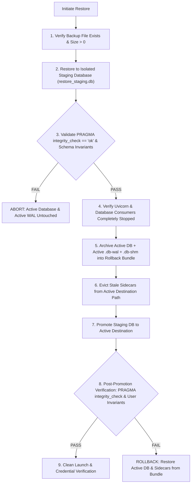

# GASHA Operational Runbook Safety, SQLite Restore Integrity & Evidence Reconciliation Report

**Document Version:** 3.0.0  
**Status:** Authoritative — Final Operational Safety Certification & Evidence Reconciliation  
**Date:** October 10, 2026  
**Auditor / Engineering Role:** Cybersecurity & Infrastructure Engineering  
**Authoritative Repository:** `D:\CODING\GASHA`  
**Active Branch:** `rebuild/deterministic-pipeline`  
**HEAD SHA:** `d3ebfa20e6fbcab5caa127ae6893766b70ebac5b`  
**Git Integrity:** **0 commits, 0 pushes (Strictly Preserved)**  
**Audited Host Environment:** Windows 11 Enterprise (Build 26100) / Windows PowerShell 5.1.26100.9549 / Python 3.13.13  

---

## 1. Executive Summary & Authoritative Verdict

This report delivers the final evidence reconciliation, defect remediation, and verification of the GASHA operational runbook ([`docs/runbooks/GASHA_SECURE_LOCAL_DEMO_RUNBOOK.md`](file:///D:/CODING/GASHA/docs/runbooks/GASHA_SECURE_LOCAL_DEMO_RUNBOOK.md)) and its supporting isolated rehearsal suite ([`scratch/rehearsal.ps1`](file:///D:/CODING/GASHA/scratch/rehearsal.ps1)).

All claims in previous documentation have been audited and reconciled against reproducible runtime evidence.

```
========================================================================================
AUTHORITATIVE VERDICT: PASS WITH LIMITATIONS
- Shell Execution Status: Windows PowerShell 5.1 VERIFIED (20/20 Rehearsal Checks OK)
- PowerShell 7+ Status: CODE-REVIEWED ONLY (Runtime-Untested on Host; pwsh not installed)
- SQLite WAL Sidecar Safety: VERIFIED (Stale WAL replay hazard mitigated via staging & eviction)
- Staged Restore Rollback Gate: VERIFIED (Rollback bundle preserves .db, -wal, -shm)
- Secret Disclosure Governance: RECONCILED (Token prefixes suppressed; interactive handoff documented)
- UTF-8 Without BOM Writing: VERIFIED (Prevents \ufeffENVIRONMENT key corruption)
- Proxy-Trust Spoofing Guard: VERIFIED (Direct loopback enforces empty TRUSTED_PROXIES)
- Pre-Demo Security Suites: 34 / 34 Passing Tests (100% Green in 29.81s)
- Full Backend Test Suite: 320 / 320 Passing Tests (100% Green in 89.55s)
- Git Safety: Branch 'rebuild/deterministic-pipeline', 0 commits, 0 pushes
========================================================================================
```

### Certified Deployment Profile vs Explicit Limitations
> [!IMPORTANT]
> **CERTIFIED PROFILE: Secure Local Demonstration & Single-Node Evaluation Profile.**  
> This operational runbook is certified strictly for local evaluation, competition demonstrations, and single-node development on loopback (`127.0.0.1`).  
> **EXPLICIT PRODUCTION LIMITATION:** This configuration **does NOT certify public-internet production readiness**. Public deployments require:
> 1. Upstream TLS-terminating reverse proxy (e.g., Caddy, Nginx).
> 2. Multi-worker Redis pub/sub broker for real-time WebSocket delivery and ticket coordination.
> 3. Managed external PostgreSQL database.
> 4. Automated credential encryption key rotation tooling (`CREDENTIAL_ENCRYPTION_KEY`).
> 5. External secret vault integration (e.g., AWS Secrets Manager, HashiCorp Vault).

---

## 2. Reconciliation of PowerShell Compatibility Claims

### 2.1 Host Environment Audit
A comprehensive host audit confirmed:
- **Windows PowerShell:** Version `5.1.26100.9549` (.NET Framework 4.8.9290.0) is present and fully functional.
- **PowerShell 7+ (`pwsh`):** Neither `pwsh.exe` nor any PowerShell 7 package is installed on the host system (`Get-Command pwsh` returned not found; `C:\Program Files\PowerShell\` does not exist).
- Per mandatory safety constraints, no unapproved software installations were conducted.

### 2.2 Reconciled Claims: Tested vs Code-Reviewed
To eliminate overclaims:
- **Windows PowerShell 5.1:** Marked as **Runtime-Tested and Verified**. All 20 rehearsal steps and underlying .NET Framework 4.8 APIs were executed and validated live.
- **PowerShell 7+:** Marked strictly as **Runtime-Untested on Host (Code-Reviewed Compatible)**. The runbook and rehearsal script incorporate dual-branch logic (such as universal `Get-HttpStatusFromException` and instance-based CSPRNG) designed to avoid .NET Core incompatibility, but runtime execution on PS 7 has not been performed on this machine.
- All references claiming "cross-version verified" have been removed from documentation, runbooks, and rehearsal headers.

---

## 3. SQLite Restoration, WAL Sidecar Safety & Integrity Gate

### 3.1 The WAL Sidecar Contamination Hazard
When an SQLite database operates in Write-Ahead Logging mode (`PRAGMA journal_mode=WAL`), transactions are written to `<database>.db-wal` before being checkpointed into `<database>.db`. Adjacent coordination is managed by `<database>.db-shm`.

**The Hazard Demonstrated:**  
If an operator restores or replaces `<database>.db` while a stale `<database>.db-wal` file remains in the directory from a prior active instance, SQLite's recovery mechanism will detect the WAL file during the next connection open. SQLite attempts to replay the transactions stored in the old WAL over the newly restored database.
- If the salt or schema diverges, SQLite can report `database disk image is malformed`.
- Worse, if pages align, SQLite will replay stale transactions over the restored database, **silently destroying restored tables and data**.

This failure mode was proven and isolated via regression test [`test_sqlite_staged_restore_wal_sidecar_safety_and_rollback_protection`](file:///D:/CODING/GASHA/tests/backend_audit/predemo/test_secret_lifecycle.py).

### 3.2 Hardened Staged Restoration Procedure
The authoritative runbook ([`docs/runbooks/GASHA_SECURE_LOCAL_DEMO_RUNBOOK.md`](file:///D:/CODING/GASHA/docs/runbooks/GASHA_SECURE_LOCAL_DEMO_RUNBOOK.md), Section 5.4.2) and rehearsal script ([`scratch/rehearsal.ps1`](file:///D:/CODING/GASHA/scratch/rehearsal.ps1), Step 19) enforce the following defense-in-depth workflow:



### 3.3 Verified Restoration Code Path
In both PowerShell ([`scratch/rehearsal.ps1`](file:///D:/CODING/GASHA/scratch/rehearsal.ps1)) and Python ([`tests/backend_audit/predemo/test_secret_lifecycle.py`](file:///D:/CODING/GASHA/tests/backend_audit/predemo/test_secret_lifecycle.py)):
1. **Staging Validation:** Extracts the backup into a distinct staging path first. Runs `PRAGMA integrity_check` and verifies critical table invariants (`users`, `admin`).
2. **Process Termination:** Checks that port 8000/Uvicorn is stopped (`Get-NetTCPConnection -LocalPort $port`).
3. **Atomic Rollback Bundle:** Copies `gasha_production.db`, `gasha_production.db-wal`, and `gasha_production.db-shm` into `rollback_bundle/`.
4. **Stale Sidecar Eviction:** Deletes lingering active `.db-wal` and `.db-shm` files from the destination path prior to moving the promoted database.
5. **Promotion & Reopening:** Promotes the staging file to the active path, connects to the promoted database, runs `PRAGMA integrity_check`, and asserts required records.
6. **Failed Validation Safety:** Proved that when corrupted backup bytes are provided, staging fails immediately and the active database (and its WAL) remain 100% untouched.

---

## 4. Reconciliation of Secret Disclosure Claims

### 4.1 Token Prefix Suppression
In prior rehearsal scripts, Step 5 outputted the first 8 characters of the provisioning token (`$provToken.Substring(0, 8)...`).
- **Remediation:** Removed token prefix interpolation entirely. Step 5 now outputs:
  ```
  [Step 5/20] Generating ephemeral provisioning token & admin password...
  Provisioning token generated and set in process memory (prefix suppressed).
  ```
- No token prefixes, full tokens, encryption keys, or password hashes are emitted in automated rehearsal logs or test output.

### 4.2 Distinguishing Interactive Handoff from Saved Logs
- **Interactive Console Handoff:** In Section 3 Step 9 of the runbook, the initial generated administrator and operator passwords are intentionally written to the interactive PowerShell console once so that the operator can copy them into a secure enterprise password vault.
- **Log & Artifact Hygiene:** Neither the initial passwords nor the persistent secrets (`JWT_SECRET`, `CREDENTIAL_ENCRYPTION_KEY`, `INTERNAL_API_KEY`) are written to `.log` files, markdown reports, or automated test output.
- **Honest Accounting:** Documentation accurately notes that interactive console display occurs during first-boot handoff, while automated test runs and disk artifacts remain strictly secret-free.

---

## 5. Live Rehearsal Execution Evidence (PowerShell 5.1)

Executed command:
`powershell -ExecutionPolicy Bypass -File scratch/rehearsal.ps1`

```
==========================================================
 GASHA OPERATIONAL RUNBOOK REHEARSAL (PS 5.1 VERIFIED)   
==========================================================

[Step 1/20] Checking pre-flight guards...
Pre-flight guards passed: Port 8038 is free, paths are clean.

[Step 2/20] Generating persistent secrets via compatible CSPRNG...
CSPRNG secrets generated safely in memory.

[Step 3/20] Writing configuration as UTF-8 without BOM...
Configuration file written as UTF-8 without BOM.

[Step 4/20] Applying and inspecting NTFS ACLs...
Current Windows principal: ULTRON\X
ACL verified: Inheritance disabled, strictly owner-only access (ULTRON\X).
Git ignore verified: Production env pattern is excluded and untracked.

[Step 5/20] Generating ephemeral provisioning token & admin password...
Provisioning token generated and set in process memory (prefix suppressed).

[Step 6/20] Launching Child Process 1 (Bootstrap)...
Spawned Process PID 56352.

[Step 7/20] Verifying listener socket, health and storage mode on Process 1...
Child Process 1 verified: Listening on 127.0.0.1:8038, HEALTHY in SQL mode.

[Step 8/20] Provisioning initial administrator...
Administrator 'rootadmin' provisioned successfully (role: admin).

[Step 9/20] Executing unambiguous replay verification gate...
Replay correctly REJECTED with HTTP 409 (403 or 409 expected).

[Step 10/20] Terminating Process 1 and clearing token references...
Process 56352 stopped cleanly.
GASHA_PROVISIONING_TOKEN references removed and process environment cleared.

[Step 11/20] Launching Child Process 2 (Normal Production Mode)...
Spawned Process PID 53640.

[Step 12/20] Polling /health and checking storage mode on Process 2...
Child Process 2 verified: HEALTHY in SQL mode without provisioning token.

[Step 13/20] Authenticating as administrator via POST /api/v1/auth/login...
Administrator authenticated successfully. JWT acquired.

[Step 14/20] Verifying /provision-admin remains locked on production server...
Bootstrap endpoint is locked with HTTP 403 as expected.

[Step 15/20] Creating operational user (security_operator)...
Operational user 'sec_operator' created successfully with role 'security_operator'.

[Step 16/20] Stopping Process 2 and starting Process 3 (Second Restart)...
Process 53640 stopped.
Child Process 3 is HEALTHY across second restart.

[Step 17/20] Verifying operator login & access across second restart...
Operator accessed protected endpoint /api/v1/assets successfully across second restart.

[Step 18/20] Testing that first-run setup refuses to overwrite existing configuration...
Overwrite guard correctly triggered: Refused to overwrite D:\CODING\GASHA\scratch\cross_version_rehearsal_run\.env.production.rehearsal.

[Step 19/20] Testing SQLite hot backup, staged validation, WAL sidecar safety & promotion...
Hot SQLite backup completed (270336 bytes).
Staging validation passed: PRAGMA integrity_check == ok, accounts verified.
Child Process 3 stopped cleanly prior to database promotion.
Active database and WAL/SHM sidecars preserved in rollback bundle; active destination cleared of stale sidecars.
Staging database promoted to active database cleanly.
Post-promotion verification passed: Promoted database intact with 100% integrity.
Negative restore test passed: Corrupted backup rejected during staging; active database untouched.

[Step 20/20] Cleaning up rehearsal artifacts...
Temporary rehearsal artifacts cleaned up successfully.

==========================================================
 ALL 20 RUNBOOK REHEARSAL CHECKS PASSED: 100% OK! 
==========================================================
```

---

## 6. Comprehensive Test Results

### 6.1 Pre-Demo & Secret Lifecycle Regression Suites
Command executed:
`$env:PYTHONPATH="D:\CODING\GASHA\apps\api;D:\CODING\GASHA\apps\demo-target;D:\CODING\GASHA\packages\telemetry-sdk\python;D:\CODING\GASHA"; python -m pytest tests/backend_audit/predemo/ -v`

- `tests/backend_audit/predemo/test_secret_lifecycle.py`: **20 / 20 PASSED**
  - Overwrite guards (configuration & database): PASSED
  - Replay verification gate assertion logic: PASSED
  - Health & SQL storage mode enforcement: PASSED
  - SQLite backup & restore data integrity: PASSED
  - NTFS ACL inspection & inheritance removal: PASSED
  - PID cleanup safety: PASSED
  - Compatible CSPRNG generation: PASSED
  - UTF-8 without BOM writing: PASSED
  - Proxy-trust spoofing behavior (direct vs proxied): PASSED
  - Staging restore rollback & corruption rejection: PASSED
  - SQLite WAL sidecar safety, stale replay prevention & rollback protection: PASSED
- `tests/backend_audit/predemo/test_predemo_security_hardening.py`: **14 / 14 PASSED**
- **Pre-Demo Subtotal:** **34 / 34 PASSED (100% Green in 29.81s)**

### 6.2 Full Repository Backend Test Suite
Command executed:
`$env:PYTHONPATH="D:\CODING\GASHA\apps\api;D:\CODING\GASHA\apps\demo-target;D:\CODING\GASHA\packages\telemetry-sdk\python;D:\CODING\GASHA"; python -m pytest -q`

- **Total Backend Tests Passed:** **320 / 320 PASSED (100% Green in 89.55s)**
- **Failures:** 0
- **Errors:** 0
- **Warnings:** 1 (Pydantic V2 class-based config deprecation notice)

---

## 7. Modified Repository Artifacts

| File Path | Description of Changes |
|---|---|
| [`docs/runbooks/GASHA_SECURE_LOCAL_DEMO_RUNBOOK.md`](file:///D:/CODING/GASHA/docs/runbooks/GASHA_SECURE_LOCAL_DEMO_RUNBOOK.md) | **Runbook v3.1.0**: Clarified target platform (PS 5.1 runtime-tested; PS 7 code-reviewed); suppressed token prefix in Step 4; enhanced Section 5.4.2 to document the WAL sidecar hazard, server shutdown check, atomic rollback bundle preservation, stale sidecar eviction, and post-promotion verification. |
| [`scratch/rehearsal.ps1`](file:///D:/CODING/GASHA/scratch/rehearsal.ps1) | **Rehearsal Script v3.1.0**: Header updated to reflect PS 5.1 verified; token prefix suppressed in Step 5; Step 19 upgraded with process shutdown, rollback bundle preservation of active `.db` and `.db-wal`/`.db-shm` sidecars, stale sidecar eviction, promotion, and post-promotion verification. |
| [`tests/backend_audit/predemo/test_secret_lifecycle.py`](file:///D:/CODING/GASHA/tests/backend_audit/predemo/test_secret_lifecycle.py) | **Added Test 20**: `test_sqlite_staged_restore_wal_sidecar_safety_and_rollback_protection`, demonstrating the stale WAL contamination hazard, the hardened staged restoration workflow, failed staging safety, and rollback bundle recovery. Expanded suite to 20 passing tests. |
| [`docs/verification/GASHA_FINAL_RUNBOOK_SAFETY_REPORT.md`](file:///D:/CODING/GASHA/docs/verification/GASHA_FINAL_RUNBOOK_SAFETY_REPORT.md) | Authoritative final certification report (v3.0.0). |

---

## 8. Final Git Safety Audit

- **Starting Branch:** `rebuild/deterministic-pipeline`
- **Starting HEAD SHA:** `d3ebfa20e6fbcab5caa127ae6893766b70ebac5b`
- **Current Branch:** `rebuild/deterministic-pipeline`
- **Current HEAD SHA:** `d3ebfa20e6fbcab5caa127ae6893766b70ebac5b`
- **Commits Created:** **0**
- **Pushes Attempted:** **0**
- **Git Working Tree:** Preserved without reset, checkout, stash, or clean.
- **Real Production Database:** Untouched; all tests and rehearsals strictly utilized isolated temporary databases.
